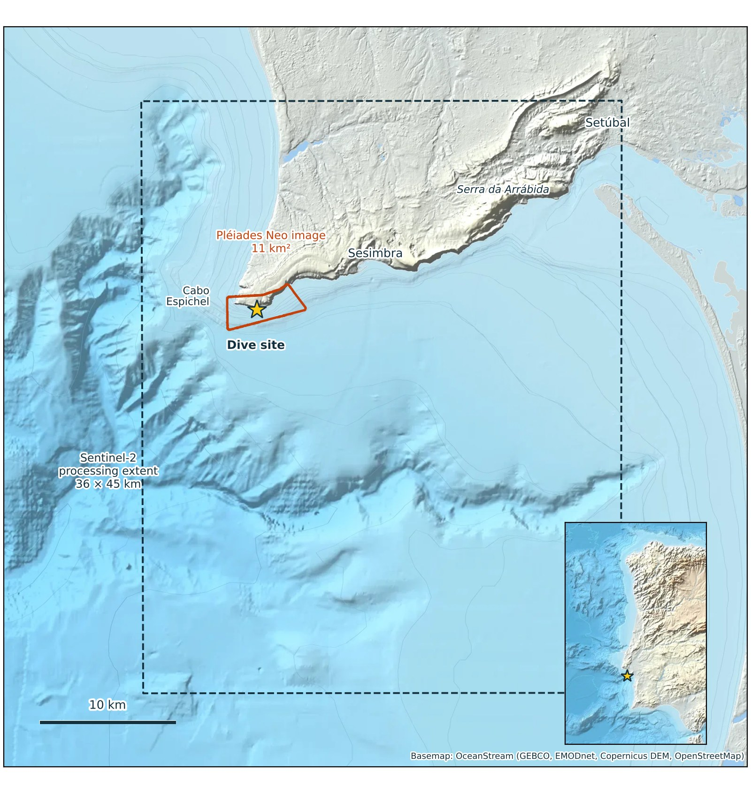
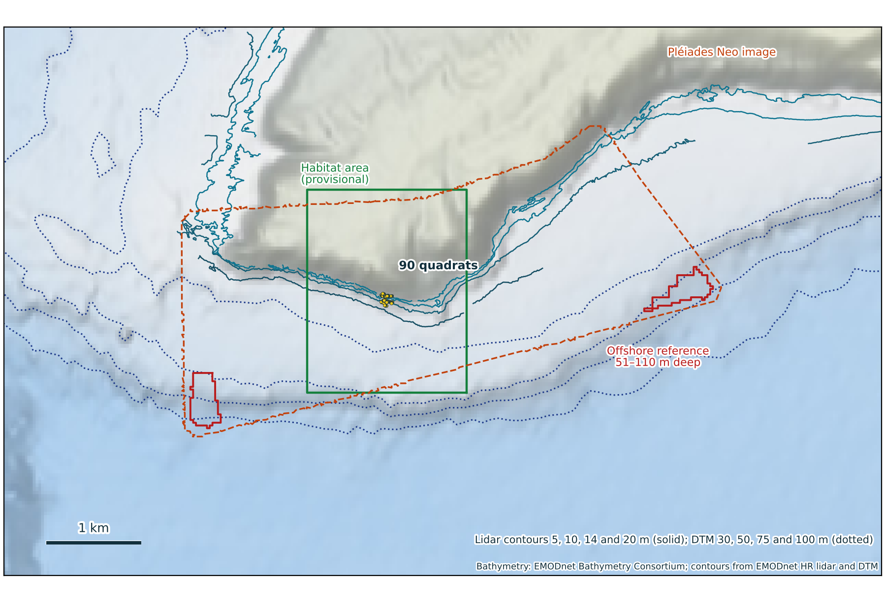
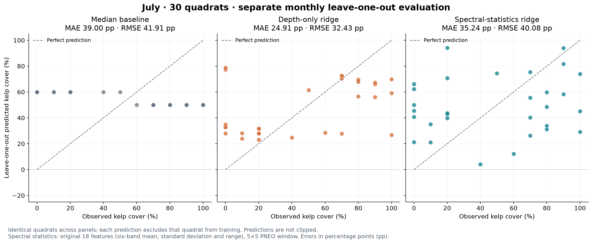
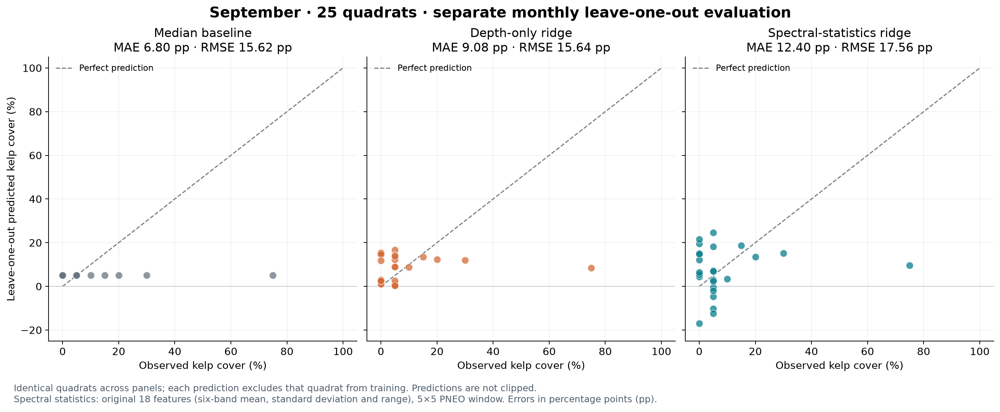

# Sesimbra kelp-cover evaluation: technical report

Results computed 2 November 2026; integration updated 5 November 2026. This separate report describes the **July and
September leave-one-quadrat-out evaluation**. It covers the non-Clay experiments
implemented in this repository. It supplements the [original technical report](technical-report.md), including its
registered and physical-retrieval experiments. The [monthly README section](monthly/README.md) is the shorter guide;
[complete metrics](../results/monthly/metrics.csv),
[held-out predictions](../results/monthly/predictions.csv) and the
[protocol](../results/monthly/protocol.json) are the numerical record.

## 1. Summary

The study asks whether satellite measurements predict the percentage of a diver's
quadrat covered by *Saccorhiza polyschides*, and whether they improve on depth or
simple predictions from the other quadrats. Each month is evaluated separately:
no July observations train a September prediction, or vice versa.

Kelp cover was much higher in July: mean cover was **48.0%**, compared with
**11.2% in September**. Median cover was **55% versus 5%**. These differences,
together with different image conditions and processing, mean that a relationship
learned in July cannot be assumed to work in September.

On identical samples, depth-only ridge had lower mean absolute error (MAE) than the
median baseline in July: **24.91 versus 39.00 percentage points**, n=30. In
September, the median was better: **6.80 versus 9.08 points**, n=25. September's
root mean squared error (RMSE) was nearly identical for these two methods.

Spectral statistics, Lyzenga indices, alternative regressors, smaller windows and
empty-quadrat subtraction did not provide clear evidence that the satellite signal
specifically detects kelp. Some methods improved individual scores, but small,
spatially related samples and repeated model comparisons limit the conclusions.
More observations across locations and months are needed before generalization
can be tested.

## 2. Site, field data and imagery

### 2.1 Site

The dive site is on the south coast of the Setúbal peninsula near Sesimbra,
east of Cabo Espichel, at approximately 38.409° N, 9.202° W. The target species is
*Saccorhiza polyschides*, the only kelp recorded in the field delivery.



*Site context retained from the study mapping. Sensor footprints and processing
extents are geographic context, not evaluation units. Basemap: OceanStream.*

### 2.2 Field observations and cover targets

CCMAR supplied June, July and September surveys. This evaluation uses July and
September, which have the paired PNEO imagery. Each survey contains 30 quadrats:
three transects in each of two depth strata, with five quadrats per transect.
Each quadrat measures **0.5 × 0.5 m** (0.25 m²).

The numerical target is the supplied quadrat percentage-cover entry. It is not
calculated by dividing positive observation points by all points. Several workbook
rows can describe individual plants in one quadrat; they are collapsed into one
survey event and one cover value. Repeated cover entries or conflicting plant and
`EMPTY` records are rejected by the aggregation code.

An explicit `EMPTY` entry produces zero cover even when the cover cell is blank.
A blank cover for a positive quadrat remains unknown. September has one such
positive quadrat, which is excluded from regression. The source files do not
establish a formal observer-error estimate or photographic cover-scoring protocol.

| Survey | Survey events | Covers available | Mean cover | Median cover | Zero-cover quadrats |
|---|---:|---:|---:|---:|---:|
| July | 30 | 30 | 48.0% | 55% | 6 |
| September | 30 | 29 | 11.2% | 5% | 10 |

The counts above describe all available covers. The matched depth comparison uses
a smaller September subset, so its baseline scores differ. Four September
observations with cover lack lidar depth; four further observations are excluded
by the quality-filtered sensitivity. Their identities and reasons are recorded in
[sample_selection.csv](../results/monthly/sample_selection.csv).

Coordinates and depth/date labels have uncertainty. In particular, the September
workbook and GeoPackage disagree on survey dates and depth labels. Repeated
transect/quadrat identifiers across months do not establish repeated measurements
of exactly the same seabed footprint. The retained
[field-input notes](monthly-inputs.md) describe these discrepancies. Source
records and hashes are available in [the input bundle](../inputs/monthly/).

[Survey maps](figures/map-3-transects.jpg) and
[habitat maps](figures/map-5-habitat.jpg) are retained as site context. They are not
training labels, independent kelp ground truth, or outputs of these models.
The survey map also shows June and a 10 m grid overlay; neither defines units in
the current quadrat-level evaluation. The habitat context includes older mapped
communities and should not be treated as a measurement of 2026 kelp cover.

### 2.3 Pléiades Neo imagery

| Property | July | September |
|---|---|---|
| Acquisition date | 8 July 2026 | 3 September 2026 |
| Order identifier | 000598128 | 000618890 |
| Delivered grid | EPSG:32629, native 1.2 m pixels | Same |
| Bands | Red, green, blue, near-infrared, red-edge, deep-blue | Same |
| Radiometric processing / atmospheric setting | REFLECTANCE / RAYLEIGH | BASIC / NONE |

Features are extracted from the delivered RGB and NED multispectral rasters. They
are not harmonized across dates, and this evaluation does not apply an ACOLITE or
CMEMS water-column correction. Separate fits avoid pooling the two products but
do not remove the effects of water, illumination, substrate or position errors.
Sentinel-2 and Clay features are not predictors in the reported experiments.

### 2.4 Depth and spatial support

Depth comes from the retained EMODnet lidar raster, with acquisition water-level
offsets of 1.6 m for July and 0.835 m for September. Missing depths are not
imputed. Because the offset is constant within each month, it has no effect on
the standardized within-month ridge predictions.



*Bathymetric context from the retained lidar and DTM mapping. Reference-region
outlines belong to the supporting optical work, not to the current evaluation
split. Attribution: EMODnet Bathymetry.*

| Native extraction window | Footprint | Area relative to a 0.25 m² quadrat |
|---|---|---:|
| 1×1 pixel | 1.2 × 1.2 m | 5.76× |
| 3×3 pixels | 3.6 × 3.6 m | 51.84× |
| 5×5 pixels | 6.0 × 6.0 m | 144× |

The single containing pixel is the closest available native support; it still
exceeds the quadrat size. Larger windows may reduce local variability while mixing
neighbouring habitat. No resampling is used to suggest a finer measurement.
[Window-overlap counts](../results/monthly/window_overlap.csv) expose shared image
support between test and training quadrats. Distinct quadrat IDs do not guarantee
independent satellite observations.

## 3. Evaluation design

### 3.1 Separate monthly leave-one-out

The evaluation asks whether the features predict cover **within a survey month**.
For each quadrat, the model is fitted on the remaining quadrats in that month and
then predicts the omitted quadrat. This uses nearly all the small monthly sample
for each fit. It does not test transfer from July to September.

| Subset | July test predictions / training quadrats per fit | September test predictions / training quadrats per fit |
|---|---|---|
| All measured covers | 30 / 29 | 29 / 28 |
| Matched cover and depth | 30 / 29 | 25 / 24 |
| Quality-filtered sensitivity | Not run separately | 21 / 20 |

The same quadrats and folds are used by each model within a reported subset.
All-cover satellite results and matched-depth results are distinct comparisons;
September n=29 spectral scores must not be ranked against n=25 depth scores.
The quality-filtered analysis uses the existing inventory flags as a sensitivity,
not as a new train/test partition.

There is no separate development set or untouched final test set. Hyperparameters
are fixed in code, but results have been inspected across multiple exploratory
experiments. The lowest score is not an independently validated model selection.
Observations from additional months, ideally across multiple years, are needed to
evaluate entire months excluded from both training and model selection.

### 3.2 Training-only operations

StandardScaler is fitted on the training quadrats in each fold, then applied to
the held-out quadrat. Ridge, SVR and PLS use this scaling; trees use raw features.
Mean and median baselines use training covers only. July's leave-one-out median
is 50% or 60%, depending on which cover is omitted; September's is always 5%.
Using the full-month median for every test prediction would include the omitted
quadrat's target.

For empty-background experiments, reference empties are selected only from the
outer training fold. The held-out cover is never used to choose or transform a
reference. Local subtraction also excludes each training quadrat from its own
reference pool. The saved [background audit](../results/monthly/background_audit.json)
lists the actual controls used.

Lyzenga calibration is different: it is an unlabelled image calculation over the
whole scene, frozen before regression. It includes image areas at held-out
locations, but does not read kelp-cover labels. This is within-scene evaluation,
not validation on a new unseen scene.

### 3.3 Metrics

MAE is the mean absolute prediction error, expressed in cover percentage points.
RMSE gives greater weight to large errors. R² measures squared-error performance
relative to the scored observations' overall mean; a negative R² means worse
squared error than that constant reference. That R² reference is not the same as
the leave-one-out mean baseline, which is recalculated without each test target.

Primary metrics use raw model predictions, including values outside 0–100%.
Clipped MAE, bias and out-of-range counts are secondary diagnostics. No confidence
interval or statistical significance claim is made from these spatially related
samples.

## 4. Features and regression models

### 4.1 Spectral features

Six band means form a six-feature model. Adding each band's population standard
deviation and range gives 18 spectral statistics. At one pixel, std/range are
zero, so these duplicate the mean-only model and are not fitted separately.

The six Lyzenga pairs are deep-blue/blue, deep-blue/green, blue/green, green/red,
blue/red and deep-blue/red. For each pair, the index is the difference between
log-transformed band signals, weighted by the scene's fitted coefficient.
Signals subtract a per-band fifth-percentile reference from a low-NIR water mask
and are floored at 0.001 before taking logs. Calibration coefficients and source
image hashes are recorded in [pneo_sources.json](../inputs/monthly/pneo_sources.json).
The indices are averaged over the same native windows as the band statistics.

The tested ridge combinations are six band means, six indices, their 12-feature
combination, 18 statistics, and statistics plus indices (24 features). The first
three are evaluated at all window sizes; the latter two at 3×3 and 5×5 only.

### 4.2 Fixed model settings

| Regressor | Settings |
|---|---|
| Ridge | StandardScaler; alpha=1; intercept fitted |
| Random forest | 300 trees; max depth=3; min samples per leaf=5; max features=1.0; seed=42 |
| Extra Trees | Same tree count, depth, leaf size, max features and seed as random forest |
| RBF SVR | StandardScaler; C=10; epsilon=5; gamma=`scale` |
| PLS | StandardScaler; 2 components; internal scaling disabled; max iterations=1000; tolerance=1e-6 |

Additional regressors use the 18 statistics from 5×5 windows on all measured
covers. They were not crossed with every window, Lyzenga combination or sensitivity
subset. Depth-only uses ridge on one depth feature. Mean and median baselines have
no satellite or depth predictors.

### 4.3 Empty-quadrat subtraction

Global subtraction removes the mean spectrum of all training empties from every
training and test row's six band means. Standard deviations and ranges are
unchanged. A constant shift cancels under subsequent training-fold
standardization, so ridge predictions should be unchanged apart from rounding.

Local subtraction uses empties from the same stratum and transect, falling back
to the training month's empty pool when no local reference exists. Training rows
use leave-self-out references. This indirectly uses depth-stratum and location
metadata, and assumes that reference substrate and water conditions are relevant.
An empty 0.5 m quadrat also does not guarantee an empty 6 m window.
Both subtraction variants were tested with ridge and Extra Trees on 5×5 statistics.

## 5. Matched depth and spectral results

July n=30; September n=25. The README figures use the median, depth and 5×5 statistics rows.

| Model | July MAE | July RMSE | September MAE | September RMSE |
|---|---:|---:|---:|---:|
| Mean baseline | 35.31 | 37.91 | 9.08 | 15.93 |
| Median baseline | 39.00 | 41.91 | 6.80 | 15.62 |
| Depth-only ridge | 24.91 | 32.43 | 9.08 | 15.64 |
| Spectral-statistics ridge, 5×5 | 35.24 | 40.08 | 12.40 | 17.56 |
| Single-pixel six-band ridge | 42.51 | 48.38 | 13.06 | 21.77 |





Each panel uses identical quadrats within its month. Points are held-out
predictions; the dashed line is perfect prediction. Points can overlap. The
spectral panel uses 18 statistics from a 5×5 window, not single-pixel features.

Depth is best among these methods for July. For September, the median baseline has
the lowest MAE; its RMSE is almost identical to depth's. Depth and the mean baseline
also have nearly identical September MAE (9.081 versus 9.083), so their rounded
tie should not be described as a meaningful depth improvement.

## 6. Other non-Clay experiments

### 6.1 All measured covers

July n=30; September n=29. These September scores cannot be compared directly with depth on n=25. Additional regressors use 5×5 statistics only.

| Method | July MAE | July RMSE | September MAE | September RMSE |
|---|---:|---:|---:|---:|
| Mean baseline | 35.31 | 37.91 | 12.97 | 18.58 |
| Median baseline | 39.00 | 41.91 | 9.66 | 18.98 |
| Band means, 1×1, ridge | 42.51 | 48.38 | 15.84 | 23.58 |
| Lyzenga, 1×1, ridge | 39.45 | 43.75 | 12.99 | 19.14 |
| Band means + Lyzenga, 1×1, ridge | 40.79 | 45.96 | 17.29 | 25.52 |
| Band means, 3×3, ridge | 35.78 | 39.11 | 15.24 | 23.90 |
| Lyzenga, 3×3, ridge | 38.00 | 42.44 | 15.34 | 22.99 |
| Band means + Lyzenga, 3×3, ridge | 37.18 | 41.76 | 21.46 | 32.59 |
| Spectral statistics, 3×3, ridge | 31.20 | 37.88 | 18.28 | 27.38 |
| Statistics + Lyzenga, 3×3, ridge | 32.71 | 38.95 | 21.24 | 32.12 |
| Band means, 5×5, ridge | 32.62 | 37.07 | 13.61 | 22.34 |
| Lyzenga, 5×5, ridge | 32.52 | 38.66 | 14.62 | 20.24 |
| Band means + Lyzenga, 5×5, ridge | 34.07 | 39.95 | 14.75 | 23.28 |
| Spectral statistics, 5×5, ridge | 35.24 | 40.08 | 12.11 | 17.84 |
| Statistics + Lyzenga, 5×5, ridge | 35.85 | 42.51 | 12.57 | 18.60 |
| Spectral statistics, 5×5, random forest | 34.24 | 37.37 | 13.37 | 18.98 |
| Spectral statistics, 5×5, Extra Trees | 33.76 | 36.36 | 11.93 | 17.72 |
| Spectral statistics, 5×5, RBF SVR | 37.49 | 41.04 | 10.61 | 17.58 |
| Spectral statistics, 5×5, PLS (2 components) | 35.52 | 39.63 | 12.99 | 21.33 |
| Spectral statistics, 5×5, ridge, global empty subtraction | 35.24 | 40.08 | 12.11 | 17.84 |
| Spectral statistics, 5×5, Extra Trees, global empty subtraction | 33.76 | 36.36 | 11.93 | 17.72 |
| Spectral statistics, 5×5, ridge, local empty subtraction | 37.15 | 42.67 | 14.37 | 22.80 |
| Spectral statistics, 5×5, Extra Trees, local empty subtraction | 35.68 | 38.29 | 13.05 | 18.63 |

The lowest July satellite MAE is 31.20 for 3×3 spectral statistics, compared with
35.31 for the mean baseline. For September, SVR has the lowest satellite MAE at
10.61, but the median baseline is lower at 9.66. SVR has lower RMSE than the median
(17.58 versus 18.98), showing that model ranking depends on the error measure.

Global empty subtraction does not improve the tested predictions. Local
subtraction increases MAE for ridge and Extra Trees in both months. The
single-pixel experiment does not improve the main spectral-statistics comparison.
These results do not establish that the larger window directly measures quadrat
cover; it may capture correlated surrounding habitat or scene conditions.

### 6.2 September quality-filtered sensitivity

The same n=21 quadrats are used for each method below. These retain the input inventory quality flags, including position/depth concerns. No additional regressors or background-subtraction variants were tested on this subset.

| Method | MAE | RMSE | R² |
|---|---:|---:|---:|
| Mean baseline | 10.57 | 17.46 | -0.102 |
| Median baseline | 7.86 | 17.01 | -0.046 |
| Depth-only ridge | 10.28 | 17.16 | -0.065 |
| Band means, 1×1, ridge | 13.82 | 23.59 | -1.012 |
| Lyzenga, 1×1, ridge | 13.65 | 21.95 | -0.743 |
| Band means + Lyzenga, 1×1, ridge | 17.10 | 29.12 | -2.066 |
| Band means, 3×3, ridge | 14.62 | 24.24 | -1.126 |
| Lyzenga, 3×3, ridge | 14.01 | 22.50 | -0.830 |
| Band means + Lyzenga, 3×3, ridge | 16.08 | 24.07 | -1.095 |
| Spectral statistics, 3×3, ridge | 10.93 | 18.38 | -0.221 |
| Statistics + Lyzenga, 3×3, ridge | 11.49 | 18.93 | -0.296 |
| Band means, 5×5, ridge | 11.64 | 18.53 | -0.241 |
| Lyzenga, 5×5, ridge | 11.30 | 17.97 | -0.168 |
| Band means + Lyzenga, 5×5, ridge | 11.92 | 18.67 | -0.261 |
| Spectral statistics, 5×5, ridge | 14.33 | 19.52 | -0.378 |
| Statistics + Lyzenga, 5×5, ridge | 14.91 | 20.93 | -0.584 |

The median remains better than depth by MAE. The sensitivity result does not
remove the need for new, independent observations or prove that quality flags
identify every source of error.

## 7. Conclusions

**Depth predicts kelp cover better than the median baseline in July, but not in
September.** On the same quadrats, July's average absolute error (MAE) is 24.91
percentage points for depth and 39.00 for the median baseline. In September, the
median baseline does better: 6.80 points versus 9.08 for depth. September's RMSE,
which gives more weight to large errors, is almost the same for both methods.

**Depth could be a confounder.** A satellite model might pick up differences in
water depth, seabed type or lighting that happen to line up with kelp cover.
Good predictions would then not necessarily mean that the model sees kelp itself.
Our experiment cannot separate these effects. A useful depth model alone does
not prove that confounding is the cause.

**We did not find clear evidence that the satellite features detect kelp itself.**
Some models improved on a baseline for a particular month or error measure, but
the results were not consistent enough to support reliable kelp detection.
This does not mean satellite detection is impossible; it means these experiments
have not demonstrated it.

The dataset is small, quadrats are close together, and some satellite windows
overlap. We also compared several models using the same observations, so the best
score may be optimistic. September's lower errors do not mean better detection:
most September observations have little or no kelp, making a low constant
prediction harder to beat. We cannot tell from this experiment why cover changed
between July and September, or assume that a model will work in another month.

**More data are needed.** We need kelp and empty quadrats at similar depths, more
accurate alignment of quadrats with satellite pixels, and observations from more
locations and different months of the year. Models should then be tested on
locations and months that were not used to train or choose them.

## 8. Known limitations

- **Small and spatially related samples.** Nearby quadrats and overlapping windows
  make leave-one-out less demanding than prediction at new locations.
- **Repeated model comparisons.** All outcomes have been inspected; the apparent
  winner can be optimistic, even with fixed hyperparameters.
- **Different months and products.** Mean cover and radiometric processing differ.
  Within-month performance does not demonstrate transfer across dates.
- **Uncertain spatial alignment.** A quadrat is smaller than one pixel; position
  errors and mixed habitat can affect all window sizes.
- **Depth and habitat effects.** A spectral association with cover could reflect
  depth, substrate, water or lighting. Excluding depth as an input does not remove
  those effects from an image.
- **Source-data limitations.** Date/depth-label discrepancies and missing values
  are recorded, but observer uncertainty in cover is not quantified.
- **No ecological attribution.** The lower September covers do not by themselves
  establish seasonal loss or another cause; sampled footprints also differ.

Supporting [E2c](../../optics/reports/e2c-sesimbra.md) and
[E5s](../../optics/reports/e5s-kelp-spectra.md) optical analyses remain useful
context. They use separate assumptions and data and do not validate the current
cover models. The upstream [r7 physical-retrieval experiment](revision-r7.md) and its CMEMS
qualification work remain separate. Their methods and results are preserved;
physical optical correction is not an input to the monthly regressors reported here.

## 9. What would make the next test informative?

Collect kelp and empty quadrats at comparable depths and on comparable substrates,
with enough examples to separate cover from depth and habitat effects. Improve
quadrat-to-image alignment and record how cover and its uncertainty are measured.

Repeat observations across different months of the year, preferably over multiple
years, and across independent locations. Fix feature/model choices before a final
evaluation. Hold out entire months and locations so that the test measures the
intended generalization rather than prediction among neighbouring quadrats in one
image. A larger sample is needed before such splits can provide reliable evidence.

## 10. Reproducing the work

Use the editable-checkout installation in the [README](monthly/README.md#running-the-monthly-evaluation).
The numerical environment is pinned in
[requirements-evaluation.txt](../../requirements-monthly.txt). To reproduce the
current results and figures without downloading imagery, run from the repository
root:

```bash
kelpobserve monthly evaluate --output out/monthly
kelpobserve monthly plot --results out/monthly --output out/monthly/figures
python -m pytest tests/monthly
```

To re-extract from licensed PNEO rasters, verify and recompute calibration, and then
evaluate the resulting input bundle:

```bash
kelpobserve monthly extract --pneo-root /path/to/pneo --recalibrate --output out/extraction
kelpobserve monthly evaluate --inputs out/extraction --output out/reextracted
```

The checked-in results contain 72 metric records and 1,968 held-out predictions.
Input hashes, per-fold training IDs, sample exclusions, background references and
window overlap are retained. The 11 monthly tests cover data handling and evaluation
invariants, including held-out target exclusion and month separation.

[Migration verification](../results/monthly/verification.json) compared 2,832
predictions with earlier exploratory experiments (some comparisons overlap), with a
maximum difference below 5 × 10⁻¹³.
[Extraction verification](../results/monthly/extraction_verification.json) checked
all 180 windows and 24 features per window against licensed imagery, with an exact
feature match. These checks establish reproduction, not predictive validity.

The [field dataset](https://doi.org/10.5281/zenodo.23282075), source hashes and
[third-party notices](../../THIRD_PARTY_NOTICES.md) document data provenance and
terms. No licensed PNEO imagery is included. The
[published software archive](https://doi.org/10.5281/zenodo.23478585) is an earlier
release; identify the commit used when citing this monthly evaluation. This file
updates the repository report only; it does not update an externally published web
report or DOI record.

## Glossary

- **Quadrat:** a 0.5 × 0.5 m field sampling area.
- **Cover:** the supplied percentage of that quadrat covered by the target kelp.
- **Leave-one-out:** train on all other eligible quadrats from the same month,
  predict the omitted one, and repeat for each quadrat.
- **MAE:** mean absolute error, in cover percentage points.
- **RMSE:** root mean squared error, which gives greater weight to large errors.
- **Median baseline:** predict the median cover of the training quadrats.
- **Confounder:** a factor, such as depth, that could explain an apparent relation
  between satellite features and kelp cover without the image identifying kelp itself.
