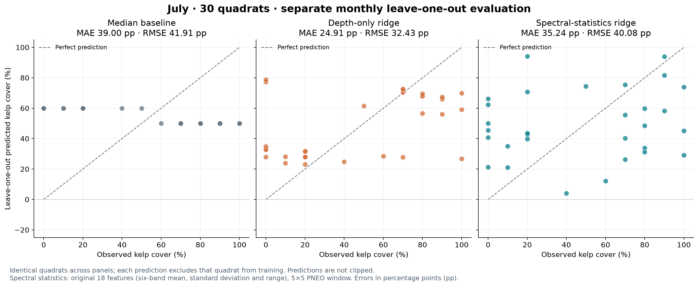
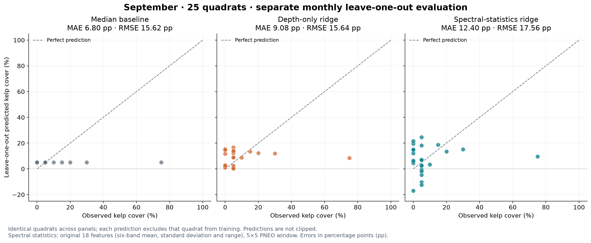

# Monthly leave-one-out evaluation

A separate exploratory analysis evaluates kelp-cover regression **within July and
within September**. It sits alongside the registered experiments and r7 physical
retrieval; it does not replace their protocols, results or replay commands.
The [monthly report](../../../benchmark/docs/monthly-evaluation.md) describes the methods,
[all monthly results](../../../benchmark/docs/monthly-results.md) and
[source-data caveats](../../../benchmark/docs/monthly-inputs.md).

## Why evaluate each month separately?

Mean kelp cover is **48.0% in July (30 quadrats)** and **11.2% in September
(29 quadrats)**; median cover is **55% and 5%**, respectively. A relationship learned in
July therefore cannot be assumed to predict September reliably.

Each quadrat is predicted from the remaining quadrats in the same month. Training,
scaling, empty-background selection and mean/median baselines never mix the two
months. These results do not establish generalization across months. More
observations throughout the year, ideally across multiple years, and tests on
entire months excluded from training and model selection are needed.

## Methods and findings

The additions include mean/median baselines, depth-only ridge, six-band PNEO
statistics and Lyzenga indices, 1×1/3×3/5×5 windows, random forest, Extra Trees,
SVR, PLS, and global/local empty-quadrat subtraction. They preserve the tested
combinations rather than fitting every possible combination. Clay-based methods
are excluded. The monthly regressors do not use the physical water-column
correction evaluated separately in r7.

The table and figures compare **identical quadrats**: July n=30 and September
n=25 with both cover and lidar depth. MAE is in cover percentage points; lower is
better. All-cover satellite results (September n=29) and the quality-filtered
sensitivity (n=21) are reported separately.

| Model | July MAE | September MAE |
|---|---:|---:|
| Mean baseline | 35.31 | 9.08 |
| Median baseline | 39.00 | 6.80 |
| Depth-only ridge | 24.91 | 9.08 |
| Spectral-statistics ridge, 5×5 | 35.24 | 12.40 |
| Single-pixel six-band ridge | 42.51 | 13.06 |





The spectral panels use 18 band mean/std/range features from a 5×5 window. This
spans 6×6 m and exceeds the 0.5×0.5 m quadrat. Even one native 1.2 m pixel is
larger than a quadrat. Predictions are not clipped. The median is recomputed per
training fold, giving 50% or 60% in July and 5% in September.

**Depth predicts cover better than the median in July, but not September by MAE.**
September depth and median RMSE are almost equal (15.64 and 15.62). Depth could be
a confounder: image features may reflect water depth, seabed or lighting that
correlates with kelp cover. These results do not prove which effect is responsible.

**We did not find clear evidence that the satellite features detect kelp itself.**
The small sample, neighbouring quadrats, overlapping windows and repeated model
comparisons limit the findings. More kelp and empty quadrats at similar depths,
better image alignment, and observations across locations and months are needed.
A lower error in September alone does not imply better detection, because most
September observations have little or no kelp.

## Running the monthly evaluation

The existing installation exposes a separate command group:

```bash
kelpobserve monthly evaluate --output out/monthly
kelpobserve monthly plot --results out/monthly --output out/monthly/figures
kelpobserve monthly extract --pneo-root /path/to/pneo --recalibrate --output out/monthly-extraction
```

Evaluation uses the checked-in `benchmark/inputs/monthly/` bundle; licensed imagery
is needed only for extraction. To evaluate re-extracted features, add
`--inputs out/monthly-extraction` to `monthly evaluate`. Defaults and paths are
owned by the monthly package; the original replay configuration is unchanged.

For the recorded numerical environment (Python 3.14.7), use a separate environment
from the Python 3.12 replay installation. From the repository root:

```bash
python3.14 -m venv out/monthly-env
out/monthly-env/bin/python -m pip install -r requirements-monthly.txt
PYTHONPATH=src out/monthly-env/bin/python -m kelpobserve monthly evaluate --output out/monthly
PYTHONPATH=src out/monthly-env/bin/python -m kelpobserve monthly plot --results out/monthly --output out/monthly/figures
PYTHONPATH=src out/monthly-env/bin/python -m pytest tests/monthly
```

The source invocation leaves the original package's Python requirement and replay
dependency pins intact. [Monthly outputs](../../../benchmark/results/monthly/) include 72
metric records, 1,968 predictions, training IDs, exclusions, background references
and overlap counts. The [protocol](../../../benchmark/results/monthly/protocol.json) records
settings and versions; the 11 monthly tests check data and evaluation invariants.

[Back to the main repository README](../../../README.md).
