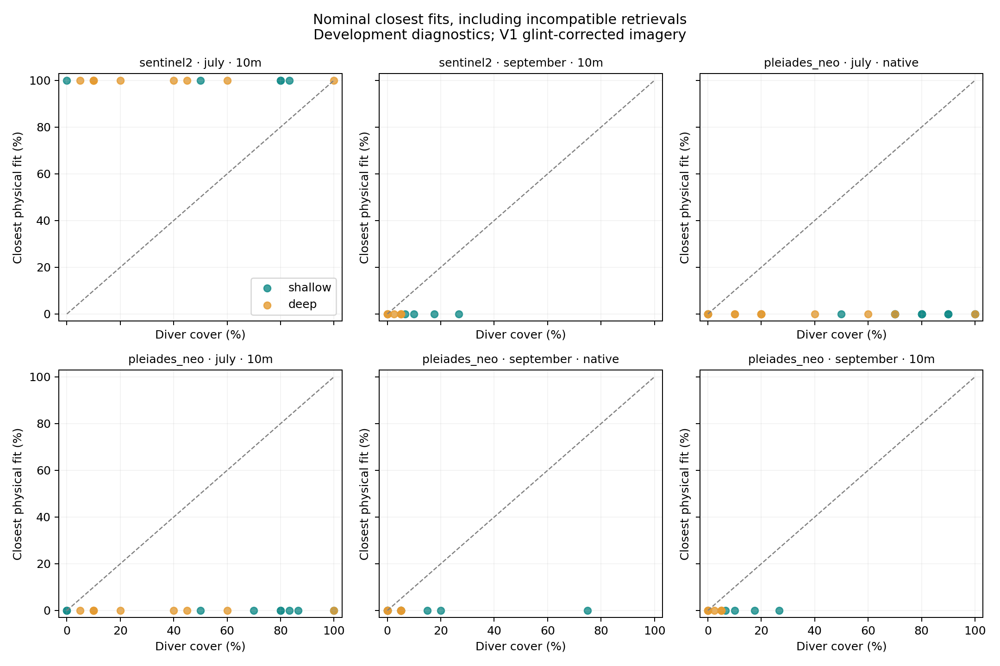

# Sesimbra r7: local physical kelp-cover retrieval

Executed 2 November 2026. **This configuration did not recover supported kelp-cover estimates from Sentinel-2 or Pléiades Neo at the surveyed locations.** July and September were each compared with their own diver observations; no July-to-September transfer was used.

The primary estimates could not reproduce the observed blue and green reflectance within the frozen tolerance. Every closest fit reached a boundary: 100% kelp for July S2, and 0% for September S2 and both PNeo dates. These are rejected retrievals. The numerical cover errors below describe their behaviour; they are not map accuracy.

| Sensor and sampling footprint | Campaign | Usable units | Spectrally compatible | Closest-fit cover | MAE on all usable units |
|---|---|---:|---:|---|---:|
| Sentinel-2, 10 m | July | 14 / 18 | 0 | 100% everywhere | 57.6 pp |
| Sentinel-2, 10 m | September | 12 / 13 | 0 | 0% everywhere | 6.5 pp |
| PNeo, native 3 × 3 pixels | July | 29 / 30 | 0 | 0% everywhere | 49.7 pp |
| PNeo, native 3 × 3 pixels | September | 18 / 22 | 0 | 0% everywhere | 8.3 pp |
| PNeo, aggregated to 10 m | July | 18 / 18 | 0 | 0% everywhere | 47.2 pp |
| PNeo, aggregated to 10 m | September | 12 / 13 | 0 | 0% everywhere | 6.5 pp |

Here, “native” uses a roughly 3.6 m sampling window over native 1.2 m multispectral pixels. The spectral-compatibility test asks whether any kelp fraction can reproduce both blue and green rhos within ±0.001. All primary cases also fail at ±0.002. This tolerance is a development diagnostic based on the earlier clean-scene variability scale, without a probability interpretation. No application cover-error threshold was supplied.

September's lower error comes from its mostly low observed cover and predictions fixed at zero. It provides no evidence that the pipeline detected kelp. In July, the depth baseline performs substantially better on identical units: MAE 27.5 pp against S2's 57.6 pp, and 22.4 pp against native PNeo's 49.7 pp. At 10 m, September's fitted-baseline comparison has only four eligible held-out cells from one transect; the full 12-cell physical error above should not be compared with that four-cell baseline. The machine-readable output records both sample sizes.

## What was tested

The [frozen development protocol](../registration/revision-r7.json) specifies a direct physical estimate. A fixed kelp/background spectral mixture passes through the Lee forward model at the unit's lidar-plus-water-level depth. Cover is searched from 0 to 100% in 0.1 percentage-point steps, with equal blue/green residual weights in above-water surface reflectance. Effective benthic reflectance from the corresponding inversion is retained without clipping for diagnosis.

The primary background is the equal mean of the E5s turf, coralline-crust and red-foliose medians. Kelp and background spectra are borrowed, sensor-convolved references. Their fractions are conditional spectral mixtures whose relationship to diver cover remains unvalidated for this three-dimensional canopy.

Water magnitude uses the repaired, product-qualified same-day Copernicus KD490 pixel. A common factor scales the winter non-water absorption/backscatter shape to match KD490. The physical model uses actual blue/green raster wavelengths with centre-band water coefficients. Summer spectral shape, reef-water representativeness, canopy geometry and nonlinear band integration remain assumptions. BBP443 and CDM443 were not fitted into this experiment.

Existing V1 glint-corrected imagery was primary; V0 was a fixed sensitivity. The candidate S2 dates were 2 July and 31 August. July S2 precedes the dives by 5–6 days. PNeo on 8 July matches the shallow survey day and follows the deep survey by one day. September imagery is 1–2 days from the unresolved 1–2 September field dates. June retains its previous unavailable-scene outcome.

The r1 pixel and area masks were retained. Mixed-transect or mixed-stratum cells were excluded from the matched analysis. Both depth strata remained in the experiment. Mean, depth-only, raw blue/green and raw-plus-depth baselines were fitted separately within each campaign, holding one transect number across both strata out and purging shared image cells. There are only three transect-number groups, so resampling intervals are descriptive; none is estimated for a single contributing transect.

## Sensitivities

The run evaluates 162 predefined scenarios per usable unit: three water magnitudes, three winter spectral shapes, depth shifts of −2/0/+2 m, understory/bare backgrounds and coherent spectral quartiles. Across sensors, footprints and V0/V1 products this produces 33,372 scenario records. They have no probability weights or calibrated confidence level.

- On primary July S2, five of 14 cells become spectrally compatible somewhere in the scenario grid. Their median union of compatible fractions spans 98.2 percentage points.
- On primary September S2, one of 12 cells is compatible in at least one scenario. This is conditional on a scenario outside the nominal retrieval.
- No primary PNeo unit becomes compatible anywhere in this grid, on either date or footprint.
- V0 September yields three nominally compatible S2 cells and two PNeo 10 m cells. The three S2 estimates are 48.4%, 100% and 92.5% against observed 17.5%, 6.7% and 10%; each admits 0–100% across the stress scenarios. The two PNeo estimates are 100% and 24.2% against 10% and 26.7%; their scenario ranges span 100 and 98.8 percentage points. One close individual estimate does not establish consistent cover retrieval.

A low residual in a selected scenario is insufficient to choose that scenario as the true water or bottom. The reported spans also expose the lack of a constrained cover estimate. The depth scenarios approximate effective-depth changes but do not model horizontal float-GPS displacement or canopy radiative transfer. Per-class quartiles do not form a measured joint spectral distribution.

## Interpretation and next work

The current combination of corrected imagery, KD490-scaled winter water optics and borrowed endmembers cannot explain the observed signal by varying kelp fraction. This experiment does not isolate which input or assumption causes the mismatch, and it does not establish a physical detection limit for either satellite. Higher PNeo spatial resolution did not resolve the mismatch in this configuration.

The [follow-up optical diagnosis](../reports/r7-optical-diagnostic-20261102/report.md) compared paired radiometry, cliff geometry and water-model closure without reading cover targets. No direct shadow is predicted at the recorded quadrat positions on these four image dates. PNeo glint correction leaves many negative offshore visible reflectances, and the KD490-scaled winter model disagrees with the same-day BBP product and offshore spectra. Separating absorption and backscatter using KD490 and BBP reduces part of the mismatch but does not produce consistent closure. Adjacency and diffuse-sky effects remain unresolved. The subsequent [PNeo glint and water review](../reports/pneo-optical-repair-20261103/report.md) tested the spectral slopes and NIR baseline separately at native resolution. Empirical slopes reduced the July overcorrection, but the retained NIR baseline transferred poorly and absolute optical closure remained unresolved. A new water helper constrains absorption and backscatter separately and reports conflicts with CDM. No branch was adopted for cover retrieval; atmospheric/adjacency treatment and independent baseline constraints remain open. Transfer and map production remain deferred.

The [bounded July atmospheric comparison](../reports/sesimbra-atmosphere-20261103/report.md) subsequently isolated the implemented Sentinel-2 adjacency term under fixed aerosol. Its offshore blue/green changes after SWIR glint correction are −0.00029/−0.00044 rhos. Automatic aerosol selection reduces the larger residual but still leaves fewer than 1% of reference cells compatible, even at ±0.002 across the non-conflicting water scenarios. PNeo’s aerosol and glint alternatives remain inconsistent between reference areas. These diagnostic tolerances do not replace the frozen cover criterion. All eight frozen r7 source files and previously manifested outputs remain unchanged; no new cover stage was run.

## Evidence and verification

The [complete result bundle](../reports/r7-local-cover-20261102-r3/report.md) contains all V0/V1 groups, native and 10 m results, per-unit exclusions, fold memberships, scenario records and the diagnostic figure. [results.json](../reports/r7-local-cover-20261102-r3/results.json) holds the metrics; [units.csv](../reports/r7-local-cover-20261102-r3/units.csv) holds the individual estimates and observations.

The protocol was fixed before new cover scoring. All labels had been used previously, so the result is development evidence. The first attempt stopped on an empty-subset reporting error. The next attempt completed; review then suppressed a degenerate one-transect bootstrap interval and added explicit matched-unit counts. Both preceding run directories are retained. The final unit predictions and all sensitivity records are identical to the completed prior run; the scientific protocol was unchanged.

Verification passed: 69 repository tests; 240 exact-input numerical controls with zero grid-aligned cover error; checksums for 62 source files and every declared output; independent metric recomputation for all 12 sensor/campaign/footprint/processing groups; and held-out-cell leakage checks. The numerical controls use the same forward physics and exact inputs, so they validate implementation only. [verification.json](../reports/r7-local-cover-20261102-r3/verification.json) records the post-run checks. The archived v1–r6 results remain unchanged.

```bash
kelpobserve local-cover --output out/local-cover/new-run
```


