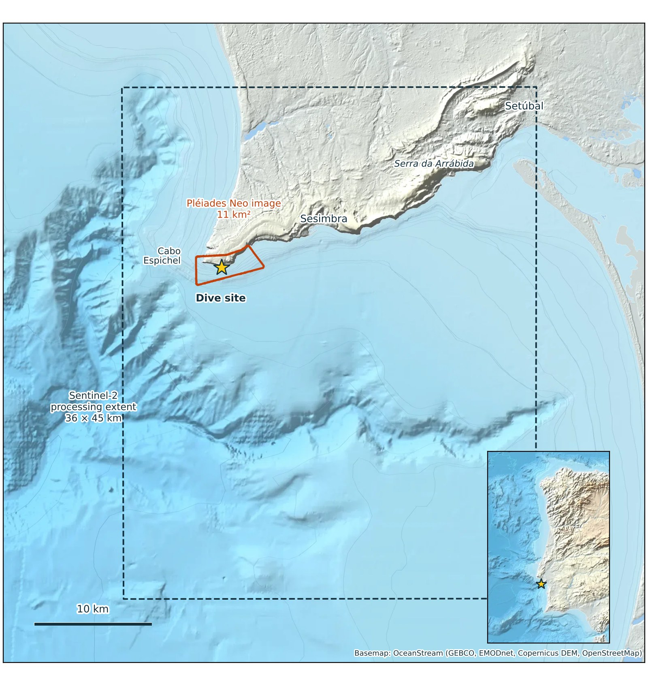
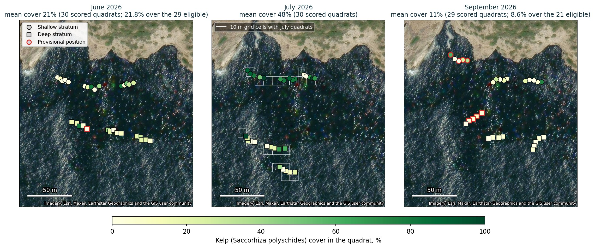
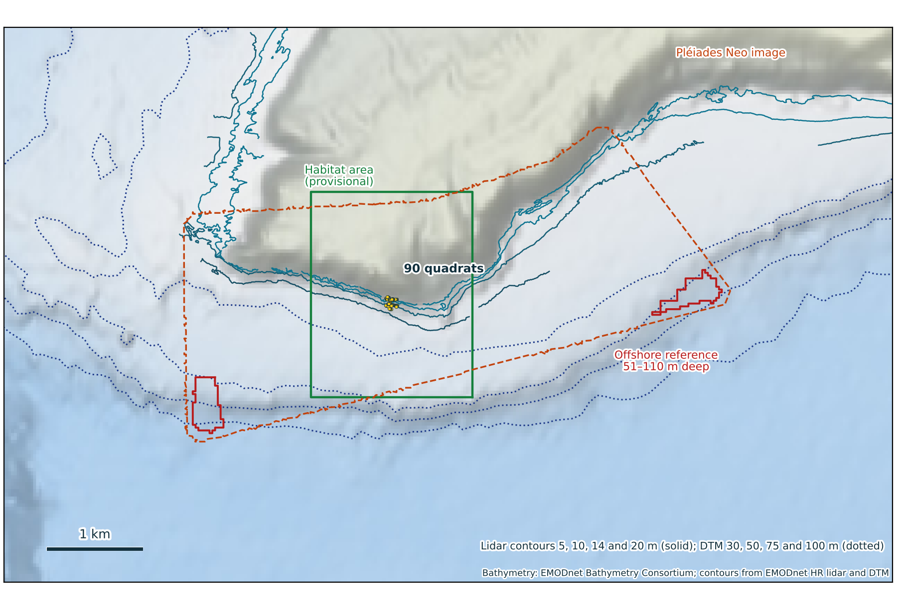
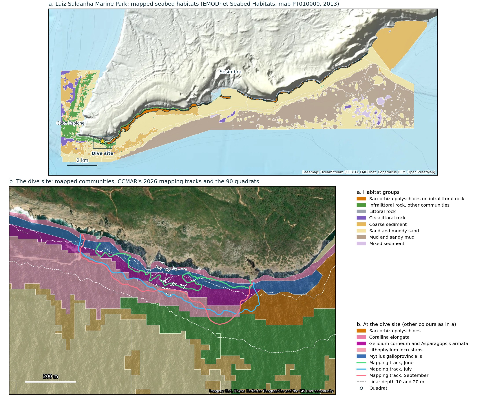
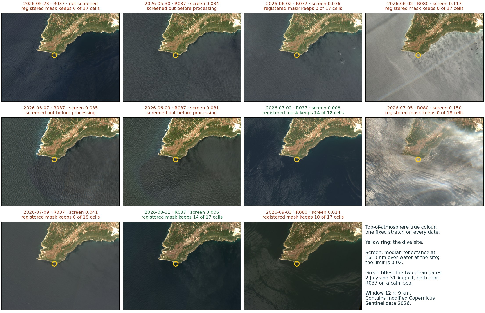
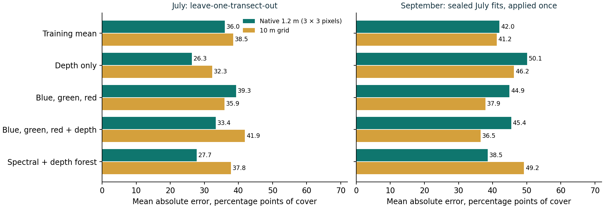
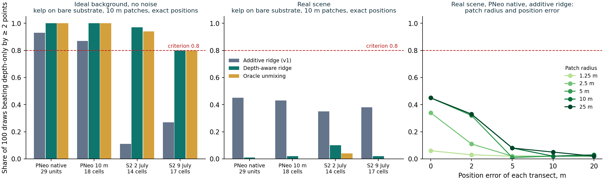

# Sesimbra kelp-cover benchmark: technical report

Updated 10 October 2026. Covers the registered experiment (v1, executed 20 September
2026), five exploratory re-analyses, r1 and r3–r6 (2 October 2026; r2
remains a draft), and the historical-habitat classification experiments of 9–10 October
2026. Sections 6.6–6.10 report the classification results and the available Clay
comparison. Supporting reports retain their historical interpretations; this
report provides the current synthesis. A story-map version for general readers is
on the KelpObserve site, under `/sesimbra/`.

## 1. Summary

**Question.** How well can Sentinel-2 and Pléiades Neo predict measured kelp percentage
cover at Sesimbra, and does water-column correction improve that prediction?

**Answer for this campaign.** Depth-only had the lowest error in the registered July
Pléiades Neo comparison and the exploratory July Sentinel-2 comparison. In September,
several spectral models beat depth-only, but every candidate transferred poorly. The
planned registered test of water-column correction could not run. Follow-up
simulations did not reach reliable recovery on the real images under the tested
spectra, water optics, sampling and models. This limits what the campaign's negative
result can establish about the sensors.

1. **Depth alone was the best predictor in July** (section 5). On Pléiades Neo, the
   depth-only model had a mean absolute error of 26.3 percentage points at native
   resolution and 32.3 on the 10 m grid. Every model using blue, green and red
   reflectance was worse.
2. **July models did not transfer to September.** Every candidate overpredicted by 35 to
   50 points. Mean kelp cover fell from 48% in July to 8.6% in September, and the models
   carried July's level forward.
3. **Three of the four registered comparisons could not run** (section 4).
   - Sentinel-2 failed the registered scene checks on every June and July date, on sun
     glint or near-shore masking.
   - The water-column-corrected branch failed its reference check on both Pléiades Neo
     dates.
4. **Summer glint at this site is routine** (section 6.1). Within a week of the June or
   July survey dates, 2 of 9 earlier years had a Sentinel-2 overpass likely to pass the
   glint screen. September had one in 7 of 9.
5. **At the campaign quadrats, the visible bands showed nothing that near-infrared did not** (section 6.1). A
   near-infrared band cannot see a seabed at 7–17 m, yet it predicted cover as well as
   blue, green and red wherever either appeared to help.
6. **Ideal-background recovery checks internal consistency, not field validity**
   (section 6.3). Physics-based models met the gain in 80–100% of draws on an ideal,
   noise-free background. On the real scenes none reached the 80% criterion across
   four sampling geometries, five patch sizes and five position errors. The spectra
   are proxies for local kelp and understory; the assumed water optics are from winter.
7. **Reflectance variation remains after accounting for depth** (section 6.4).
   Associations differ by image: a strong NIR-coherent term consistent with glint on
   Pléiades Neo in July, a near-shore term in September, and a persistent spatial
   pattern alongside date-specific variation on Sentinel-2. These do not uniquely
   identify the causes or establish a seabed signal.
8. **Three remedies were tested and none was sufficient** (section 6.5): glint
   correction, averaging two Sentinel-2 dates, and removing a fixed background offset.
9. **Published habitat maps place the quadrats on rock with coralline and red algae,
   not in the mapped kelp class** (section 2.6). The marine park's 2013 habitat map
   holds 166 ha of *Saccorhiza* habitat in five strips along this coast; the nearest
   starts 230–370 m east of the quadrats. The Europe-wide EUSeaMap does not resolve
   the reef at all.

> Across the tested Sesimbra campaign geometries, neither glint correction, two-date
> Sentinel-2 averaging, nor removal of fixed background offsets enabled reliable recovery
> of the simulated kelp-cover signals. The experiments identify strong dependence on
> observation conditions, spatial variation and model formulation. They provide a
> quantified limitation of this campaign benchmark, rather than a general limit on
> satellite kelp detection.

**Positive exploratory finding beyond the quadrat-cover benchmark.** A random forest
using glint-corrected, scene-normalised Sentinel-2 visible bands and depth separated
historical *Saccorhiza* from red/coralline habitat zones across 2 July and 31 August
2026. Mean spatial-fold AUC was 0.915 in both transfer directions on 300 depth-matched
20 m patches. The seven additional dates gave a lower mean AUC of 0.706 under the
same 300 m folds. This supports further testing for habitat-zone mapping and survey
planning; the reference classes date to 2013 and current kelp occurrence and cover
remain unverified. The saved Clay experiment uses a different target and sample,
so relative model performance is unresolved (sections 6.6–6.7).

Training across eight dates did not improve transfer to a withheld ninth date.
Mean spatial-fold AUC was 0.718 for pooled training and 0.756 for the original
July/August models under the same evaluation. Location and depth reached 0.791.
The wider 1 km spatial holdout also favoured the original models over pooled
training (section 6.8). A subsequent fixed image-quality screen retained 3 of 11
scenes. On the additional 3 September scene, the original model ensemble reached
AUC 0.791 under 300 m blocks and 0.821 under 1 km sections. The screen excluded a
second additional scene whose AUC was 0.410 and 0.426. This supports further testing
of scene screening, with substantial limits on available dates (section 6.9).

The final six-date test retained one date with complete predictions. On retained dates, mean AUC under 300 m blocks was 0.835 for the habitat model and 0.791 for location and depth (paired gain +0.044). Stop tuning the historical-label model and prioritise additional spatial evidence from existing video and observations covering model footprints. The bounded test and prepared reference-data worklist are reported in section 6.10.

## 2. Site, field data and imagery

### 2.1 Site

The dive site is on the south coast of the Setúbal peninsula, just east of Cabo
Espichel, at 38.409° N, 9.202° W. The target is *Saccorhiza polyschides*, the only kelp
recorded in the delivery.

*Map 1. The dive site (star), the Sentinel-2 processing extent (dashed, 36 × 45 km)
and the Pléiades Neo image footprint (orange, 11 km²). Basemap: OceanStream.*

### 2.2 Field data

CCMAR divers surveyed in three campaigns: 2 June, 7–8 July and 1–2 September 2026.

- **Design.** Three transects in a shallow stratum (about 7 m) and three in a deep
  stratum (about 16 m), five 0.25 m² quadrats on each: 30 quadrats per campaign, 90 in
  all, inside about 120 × 140 m. Neighbouring transects are 25–53 m apart.
- **Target.** Visual estimate of *Saccorhiza* percentage cover per quadrat. Recorded
  absences count as zero. One September quadrat is kelp-positive with no cover recorded
  and is excluded from regression.
- **Positions.** GPS on a surface float towed by the divers, so a position can be
  several metres from the quadrat.
- **Eligibility.** 81 of 90 events passed the registered join and depth checks. Nine
  are provisional: five disagree with lidar depth by more than 3 m and four have no
  lidar depth. Eight of the nine are in September.
- **Roles.** July is the development campaign and September the sealed holdout. June
  was a supplementary Sentinel-2 campaign with no Pléiades Neo image.

| Campaign | Scored quadrats | Mean cover | Shallow | Deep | Eligible, mean cover |
|---|---:|---:|---:|---:|---|
| June | 30 | 21% | 23% | 19% | 29 quadrats, 21.8% |
| July | 30 | 48% | 70% | 26% | 30 quadrats, 48.0% |
| September | 29 | 11% | 18% | 4% | 21 quadrats, 8.6% |

Same-label quadrats moved 21–102 m between July and September, so September tests
transfer across a season at re-laid positions, not a repeat of the same points.

*Map 3. Kelp cover per quadrat in each campaign. Circles are shallow, squares deep;
a red outline marks a provisional position. White squares in the July panel are the 18
cells of the 10 m grid that contain July quadrats. Imagery: Esri World Imagery.*

### 2.3 Imagery

| Sensor | Dates used | Pixel | Bands used | Notes |
|---|---|---|---|---|
| Pléiades Neo | 8 July (11:38 UTC), 3 September (11:34 UTC) | 1.2 m | blue 486, green 563, red 655, NIR 826 nm | No shortwave infrared. July delivered Rayleigh-corrected, September as basic radiance |
| Sentinel-2 | Candidate overpasses in the three matchup windows: 8 processed, 14 screened out on glint | 10 m (20 m for 1610 nm) | blue 492, green 560, red 665, NIR 833, SWIR 1610 nm | Orbits R037 and R080 only, tile T29SMC |

Both sensors were processed with one pinned ACOLITE revision (`64a02ff`, dark-spectrum
fitting) and registered settings.

### 2.4 Depth and water level

- **Depth.** EMODnet high-resolution lidar (`590_HR_Lidar_Sul`, surveyed 2011, about
  11 × 14 m cells, chart datum LAT). It reaches about 29 m. Deeper reference water uses
  the standard EMODnet DTM.
- **Water level.** Modelled sea level at each acquisition from the Copernicus Marine
  IBI analysis, referred to a LAT proxy with 0.3 m datum uncertainty. Model depth is
  lidar depth plus the acquisition water level.

*Map 2. Lidar contours at 5, 10, 14 and 20 m and DTM contours at 30 to 100 m; the
provisional habitat rectangle (green); the offshore reference region, 51–110 m deep and
0.287 km² (red); the Pléiades Neo image footprint (dashed). Basemap: EMODnet
Bathymetry.*

### 2.5 Spatial support

- **Native Pléiades Neo.** The mean of 3 × 3 pixels (3.6 m) centred on each quadrat.
- **Common 10 m grid.** The Sentinel-2 tile grid. Pléiades Neo is area-averaged onto
  it. A cell needs 80% valid area. The 30 July quadrats occupy 18 cells; cover per cell
  is the mean of its quadrats, labelled as a sampled mean and not full-cell truth.
- **Scale mismatch.** A quadrat is 1/400 of a 10 m cell and about 1/50 of a native
  unit.

### 2.6 Habitat context from published maps

Two published habitat maps cover the site, both served by EMODnet Seabed Habitats and
downloaded on 2 October 2026 (`benchmark/habitat_map.py`, with provenance in
`.cache/emodnet-habitats/`). Neither was used in the experiment; they are context.

- **The marine park map (PT010000).** Seabed habitats and associated communities of
  the Luiz Saldanha Marine Park, compiled in 2013 from the LIFE Biomares surveys and
  IPMA data, in EUNIS 2012 classes: 439 polygons over 8,598 ha. It names a unit
  *Saccorhiza polyschides* on infralittoral rock (A3.31_PT16): **166 ha in five
  strips** along the coast between Cabo Espichel and Sesimbra. On the lidar, that
  class lies at **4.8–13.6 m** (10th–90th percentile of 5,065 cells, median 9.3 m).
  Infralittoral rock with other communities covers 428 ha, sand and muddy sand
  3,344 ha, mud 2,868 ha.
- **EUSeaMap 2025.** The Europe-wide broad-scale predictive map (EUNIS 2019). Its
  polygons do not reach the quadrats: the nearest is 31–138 m away and is classed as
  Atlantic infralittoral sand; the nearest rock class is 773 m away.

*Map 5. a. The marine park map by habitat group, with the Saccorhiza class outlined.
b. The dive site: the mapped communities, CCMAR's GPS mapping tracks from each 2026
campaign, the lidar 10 and 20 m contours and the 90 quadrats. Basemaps: OceanStream
and Esri World Imagery.*

Where the park map places the quadrats (a point-in-polygon join on recorded
positions):

| Campaign | Stratum | Mapped community, 2013 | Quadrats |
|---|---|---|---:|
| June | shallow | *Mytilus galloprovincialis* on infralittoral rock | 13 |
| June | shallow | *Corallina elongata* on infralittoral rock | 2 |
| June | deep | *Gelidium corneum* and *Asparagopsis armata* on infralittoral rock | 15 |
| July | shallow | *Corallina elongata* on infralittoral rock | 12 |
| July | shallow | *Mytilus galloprovincialis* on infralittoral rock | 3 |
| July | deep | *Lithophyllum incrustans* on infralittoral rock | 9 |
| July | deep | *Gelidium corneum* and *Asparagopsis armata* on infralittoral rock | 6 |
| September | shallow | *Corallina elongata* on infralittoral rock | 10 |
| September | shallow | outside the mapped polygons | 5 |
| September | deep | *Gelidium corneum* and *Asparagopsis armata* on infralittoral rock | 15 |

- **No quadrat falls in the mapped Saccorhiza class.** The nearest strip starts
  229–370 m east of the quadrats.
- **The mapped communities at the quadrats are coralline and red algae and mussels.**
  That is consistent with the understory used as the realistic background in the
  simulations (turf, coralline crust and red foliose algae), but it is a 2013 map of
  dominant communities, not a 2026 measurement, and *Saccorhiza* is seasonal. Positions
  carry the float-GPS error of section 2.2, and the five September quadrats outside
  any polygon are the provisional positions on the shore.
- **CCMAR's mapping tracks.** The September delivery includes one GPS track per
  campaign from the kelp mapping dives, 1.1–1.3 km long, running along the seaward
  side of the reef. What each track delineates has not been confirmed with CCMAR, so
  they are shown as tracks and not as a kelp boundary.
- **Public occurrence records.** The project's OBIS extract of kelp and seagrass
  records (14 species, 2015 onwards) holds no kelp record within the Setúbal
  peninsula region; the only record there is a seagrass sighting near Setúbal.

## 3. Registered design

### 3.1 Models and evaluation

Five candidate families, the same at each scale:

| Family | Predictors |
|---|---|
| Training mean | none |
| Depth-only ridge | depth |
| Spectral ridge | blue, green, red |
| Spectral + depth ridge | blue, green, red, depth |
| Spectral + depth forest | blue, green, red, depth (300 trees, depth 3, minimum leaf 5) |

- **Development.** Leave-one-transect-out on July, holding out both strata of a
  transect together. Each fold needs at least 8 training units, 3 per stratum.
- **Holdout.** Fits sealed and checksummed, then applied once to September.
- **Metrics.** Mean absolute error (MAE), root-mean-square error and signed bias, in
  percentage points of cover, with a paired comparison against depth-only.
- **Comparator.** Depth-only. The two strata average 70% and 26% cover, making depth
  an important baseline. It is the best tested July predictor by MAE, not an
  explanation of most cover variation. Calculated from the saved v1 July
  cross-validation predictions, its ordinary R² is 0.13 natively and −0.33 on the
  10 m grid; both compare squared error with deviations from the scored units' mean.

### 3.2 How the protocol was kept

- Choices were registered in `registration/experiment.json` before the affected data
  were examined. Each later change is a dated amendment that keeps the original outcome.
- Scenes were selected on image quality only, never on how well they predict cover.
- Fitting could not open the held-out targets, and evaluation refused to run twice.
- An input lock pinned sources, processed imagery, registration and library
  source.
- Each exploratory re-analysis was registered in `registration/revision-rN.json` before
  it was computed. Weaknesses found afterwards are recorded there as errata, not
  repaired.

## 4. What could run

| Registered branch | Status |
|---|---|
| Uncorrected Pléiades Neo, native and 10 m | Ran |
| Sentinel-2 on the 10 m grid | Unavailable: sun glint and near-shore masking |
| June Sentinel-2 supplement | Unavailable: no qualifying scene |
| Water-column-corrected variants | Unavailable: reference check fails on both dates |

### 4.1 Sentinel-2 scene selection

Full detail: [scene-selection.md](scene-selection.md).

Registered checks: median surface reflectance at 1614 nm under 0.01 (glint), at least
80% valid water in the habitat area, and at least 80% of the cells holding quadrats
valid.

| Scene | Orbit | Glint (limit < 0.01) | Valid water | Quadrat cells | Verdict |
|---|---|---:|---:|---:|---|
| 28 May | R037 | 0.0222 | 29.9% | 0/17 | rejected |
| 2 June | R037 | 0.0310 | 0.0% | 0/17 | rejected |
| 2 June | R080 | 0.1099 | 0.0% | 0/17 | rejected |
| 2 July | R037 | **0.0040** | **97.1%** | 14/18 | rejected on cells |
| 5 July | R080 | 0.1127 | 0.0% | 0/18 | rejected |
| 9 July | R037 | 0.0295 | 0.0% | 0/18 | rejected |
| 31 August | R037 | 0.0027 | 97.8% | 14/17 | selected for September |
| 3 September | R080 | 0.0155 | 91.8% | 10/17 | rejected |
| Pléiades Neo 8 July | – | NIR 0.038 over water | 90.9% | 30/30 | accepted |
| Pléiades Neo 3 September | – | NIR 0.011 over water | 88.6% | 25/30 | accepted |

A further 14 candidate dates were screened out on measured glint before processing.

- **Cause.** In summer both orbits view the sea near the specular direction: 11° from
  it on R080 (median glint 0.11) and 27–28° on R037 (0.03). A calm sea narrows the
  glint lobe, which is why 2 July and 31 August are clean on R037 while other R037
  dates are not.
- **Second failure mode.** The shallow cells nearest the cliffs are masked on every
  date, where the 20 m SWIR band mixes in land or surf. The shallow stratum carries the
  highest cover, so this loss is not neutral.
- **The July near miss.** 2 July passed on glint and valid water and failed the cell
  check by one cell: 14 of 18, where 15 are needed. The verdict is fragile and was
  left as registered.
- **Consequence.** With no July scene there was nothing to fit, so the 31 August scene
  was kept for diagnostics only.

*Map 4. Top-of-atmosphere true colour for every processed Sentinel-2 overpass, with one
fixed stretch. "Screen" is the median reflectance at 1610 nm over water at the site
(limit 0.02). Contains modified Copernicus Sentinel data 2026.*

### 4.2 Water-column correction readiness

Full detail: [optics-readiness.md](optics-readiness.md).

The corrected branch needed plausible water optical properties from a QAA fit over a
deep-water reference region, registered from depth and distance alone.

| Quantity | 8 July | 3 September | Expected, clear coastal water |
|---|---:|---:|---|
| K_d at 486 nm (m⁻¹) | 1.32 | 1.26 | 0.05–0.2 |
| Particle backscatter at 555 nm (m⁻¹) | 0.126 | 0.120 | 0.001–0.01 |
| Reference wavelength chosen | 655 nm | 655 nm | blue or green |

- **Both fits failed.** The values are the signature of a bright, spectrally flat
  signal over deep water.
- **Cross-sensor check.** Against the clean 31 August Sentinel-2 scene, Pléiades Neo
  read 0.006–0.012 higher over water. Its NIR of 0.019 is far above the 0.006 that
  clear water gives.
- **Cause.** Pléiades Neo has no SWIR band to constrain the atmospheric correction, and
  8 July is near-specular. The residual, 0.01–0.04, is as large as the seabed contrast
  at 7–17 m.
- **Rule weakness found later (r1).** The registered rule could never pass on this
  sensor: one of its flags fires for any sensor without a band near 411 nm. Removing
  that flag does not rescue the fit, so the branch stays unavailable (section 6.1).

## 5. Registered results

Full detail: [results.md](results.md).

*Chart 1. Mean absolute error of each candidate. Left: July, leave-one-transect-out.
Right: the sealed July fits applied once to September.*

**July, leave-one-transect-out** (30 quadrats, 18 cells; percentage points):

| Candidate | 10 m MAE | 10 m bias | Native MAE | Native bias |
|---|---:|---:|---:|---:|
| Training mean | 38.5 | +2.0 | 36.0 | +0.0 |
| **Depth-only ridge** | **32.3** | +1.1 | **26.3** | +0.2 |
| Blue/green/red ridge | 35.9 | +7.7 | 39.3 | −0.7 |
| Blue/green/red + depth ridge | 41.9 | +13.9 | 33.4 | −0.3 |
| Spectral + depth forest | 37.8 | +2.9 | 27.7 | +2.2 |

- Paired against depth-only, every spectral candidate is worse: by 3.7 to 9.6 points on
  the grid and 1.4 to 13.0 natively.

**September, sealed fits applied once** (22 eligible quadrats, 21 scored; 13 cells):

| Candidate | 10 m MAE | 10 m bias | Native MAE | Native bias |
|---|---:|---:|---:|---:|
| Training mean | 41.2 | +41.2 | 42.0 | +39.4 |
| Depth-only ridge | 46.2 | +46.2 | 50.1 | +50.1 |
| Blue/green/red ridge | 37.9 | +34.7 | 44.9 | +42.4 |
| Blue/green/red + depth ridge | 36.5 | +36.5 | 45.4 | +45.4 |
| Spectral + depth forest | 49.2 | +49.2 | 38.5 | +37.3 |

- **MAE and bias are nearly equal for every candidate,** so the error is a level shift,
  not misplaced spatial detail. Of 21 scored September quadrats, nine are 0% and eight
  are 5%.
- **Depth-only, best in July, is worst in September,** because the July depth gradient
  no longer holds.
- **The water also changed.** CCMAR sonde casts a day before each Pléiades Neo image
  show stratified water in July and mixed water in September, with chlorophyll
  fluorescence about five times higher at 15–17 m. That can shift the spectral
  predictors independently of cover. The sonde has no light sensor, so the effect
  cannot be quantified.

**Limits of the registered result.**

- The reflectance fed to the spectral models carried the additive term of section 4.2,
  so this was not a fair test of the physics.
- Eighteen cells and three transects inside 120 × 140 m. Folds are neighbouring
  transects, not independent sites.
- With two strata, depth-only is close to a stratum-mean model, and the design
  confounds depth with cover.

## 6. Exploratory re-analyses

An external review on 2 October 2026 raised six findings about v1. All six held.
Five executed revisions followed, each registered before it ran; r2 remained a draft.
Every cover value had already been seen, so none replaces a v1 result.

| Revision | Question | Outcome |
|---|---|---|
| r1 | Do the review's findings change v1? | Ranking unchanged under consistent quality control. In an injection test the registered models did not reliably recover injected signals |
| r2 | Draft protocol for glint-tolerant admission | Not executed |
| r3 | Can a glint-tolerant mask admit summer Sentinel-2 scenes? | Water admitted, but no glinted scene passed the registered acceptance checks |
| r4 | Which conditions would allow recovery? | None on the real scenes; 80–100% on an ideal background |
| r5 | What is the variation that depth does not explain? | Different on each sensor and date |
| r6 | Do glint correction, date combination or offset removal reach recovery? | No |

### Simulation assumptions

The recovery experiments use the following inputs from the
[E5s spectral analysis](../../optics/reports/e5s-kelp-spectra.md).
Their scope is conditional on these choices, not a measured local detection limit.

| Input | Basis | Qualification |
|---|---|---|
| Campaign sampling | Recorded positions, lidar plus acquisition water level, actual valid-pixel masks and unit footprints | Measured or derived campaign inputs, with position and depth uncertainty |
| Kelp spectrum | Taxon-balanced spectral-library class, including Australian/New Zealand genera and *Chorda* | No measured Iberian *Saccorhiza polyschides* spectrum; shared pigments motivate the proxy |
| Understory | Mean of turf, coralline crust and red foliose classes | Largely tropical library spectra standing in for Atlantic communities; not measured local understory |
| Water optics | Two winter Sesimbra scenes, forced-green QAA; median optics and a more attenuating sensitivity case | Not direct measurements of July or September optical properties |
| Bottom and canopy | Mixtures of single-material spectra, with attenuation through lidar-derived water depth | Upright submerged fronds and canopy geometry are not explicitly represented |
| Spatial support in r4–r6 | Discs of radius 1.25–25 m on a 1 m grid, sensor averaging and nominal Gaussian blur of σ = 0.5 pixel | Assumed bed geometry and point-spread function; sensitivity variants do not span every plausible configuration |

The ideal-background checks generate and recover signals with compatible physics.
They test implementation consistency under these assumptions, not the validity of
the spectra, water optics or canopy model in the field. The 100 draws repeat a
simulation using the same campaign data; they are not 100 independent field tests.

### 6.1 r1: the review, checked and applied

Full detail: [revision-r1.md](revision-r1.md).

**Consistent quality control.** v1 had not applied the pixel mask to the predictors.
Applying it removed one July native unit and three September ones. v1's own numbers
reproduce exactly under v1's rule.

| Candidate, July MAE | Pléiades Neo native (29) | Pléiades Neo 10 m (18) | Sentinel-2 2 July (14 cells) |
|---|---:|---:|---:|
| Training mean | 34.9 | 38.5 | 34.2 |
| **Depth-only ridge** | **22.4** | **32.3** | **27.5** |
| Blue/green/red ridge | 38.1 | 35.8 | 32.9 |
| Blue/green/red + depth ridge | 25.8 | 41.7 | 31.2 |
| Spectral + depth forest | 24.1 | 37.8 | 34.0 |
| *Control:* NIR ridge | 35.9 | 36.4 | 28.2 |
| *Control:* NIR + depth ridge | 26.0 | 40.8 | 27.7 |

- **Depth-only stays best on every sensor and scale.** Removing one unit moved one
  native MAE by 7.6 points, so v1's margins between spectral models were fragile.
- **The near-infrared control matches the visible bands.** Natively, NIR + depth (26.0)
  ties blue/green/red + depth (25.8). On Sentinel-2, NIR alone (28.2) beats every
  visible-band model. Water absorbs NIR within about a metre, so that skill comes from
  something correlated with cover and depth, such as glint, adjacency or position.
- **Position sensitivity.** Shifting every position by 2–20 m in eight directions moved
  the comparison by about ±7 points. Differences smaller than that are not
  interpretable with 18–30 units.
- **The 10 m forest is mostly an intercept.** With 11–13 training cells and a minimum
  leaf of five, 241–296 of its 300 trees never split.

**Radiometry without labels.** One glint-correction variant per sensor, using settings
of the pinned ACOLITE.

- **Sentinel-2:** the SWIR-based correction lowered offshore NIR by 0.003–0.006 and
  nearly removed the near-shore NIR depth slope, wherever water survived the mask.
- **Pléiades Neo:** the NIR-referenced correction gave the first plausible reference
  fit on 3 September (backscatter 0.0059 m⁻¹, K_d(490) 0.24 m⁻¹). On 8 July it
  over-corrected, so the corrected branch still had no July fit to train on.
- **A gain gap v1 missed.** Over land, Pléiades Neo reads 18–27% below Sentinel-2 in
  green and red on both dates. v1 reported only the correlation, which cannot see a
  gain.

**Injection and recovery.** A synthetic cover target (July cover permuted within each
stratum) was painted into the real 8 July reflectance as 2.5 m discs. The signal came
from the coastal library's forward model. "Recovered" means the spectral + depth model
beats depth-only by at least 2 points in 80% of 100 draws.

| Signal for 100% kelp, change in reflectance at 486 / 563 nm | Shallow (7–9 m) | Deep (17 m) |
|---|---|---|
| Against understory algae (realistic here) | +0.002 / +0.004 | +0.0001 / +0.0003 |
| Against bare rock and sand (optimistic bound) | −0.023 / −0.025 | −0.0014 / −0.0015 |

- **No condition met the criterion.** With bare substrate and exact positions, the
  native ridge met the 2-point gain in 46% of draws and the native forest in 70%. With
  a 5 m position error both fell to 2–7%.
- **Kelp over understory was indistinguishable from no signal** (4% against a null of
  5%).
- **Scope.** This shows that the registered models, on these units and under a 2.5 m
  patch model, did not reliably recover injected signals. v1's negative result is
  therefore inconclusive about the sensor.

**Campaign windows, 2017–2025.** Years with at least one overpass likely to pass the
glint screen:

| Window around the survey dates | June | July | September |
|---|---:|---:|---:|
| ± 3 days | 1 of 9 | 1 of 9 | 5 of 9 |
| ± 7 days | 2 of 9 | 2 of 9 | 7 of 9 |
| ± 14 days | 4 of 9 | 4 of 9 | 8 of 9 |

- Orbit R080 never qualified in June or July: all 94 non-cloudy overpasses failed on
  geometry.
- These are counts of overpasses passing a fixed screen. They do not bound what better
  glint processing could recover, and they do not establish that survey dates must
  move.

### 6.2 r3: a glint-tolerant Sentinel-2 mask

Full detail: [revision-r3.md](revision-r3.md).

The registered mask reads top-of-atmosphere 1610 nm, which glint correction does not
change, so it removes every water pixel on a glinted date. r3 raised the threshold by
each scene's glint above clean conditions and added five label-free acceptance checks
with limits set from the two clean dates.

- **The mask admits the water.** Every glinted R037 scene kept 97–99% of its water, and
  9 July kept 17 of 18 cells.
- **No glinted scene passed all five checks.** Four failed a single check, most
  narrowly. A block bootstrap puts the near misses inside their own sampling
  uncertainty.
- **Glinted dates show more small-scale variability and overcorrection.** Scatter
  between neighbouring offshore pixels is 1.4–3 times the clean scenes', and 5–28% of
  offshore pixels have negative NIR after correction.
- **Scope.** This was one mask, one correction and one acceptance rule, and the checks
  have recorded weaknesses. It does not show that summer scenes cannot be recovered.

### 6.3 r4: detectability envelope

Full detail: [revision-r4.md](revision-r4.md).

r4 asked which combinations of geometry, patch size, position error and noise allow
recovery.

- **Geometries.** Pléiades Neo 8 July, native (29 units) and 10 m (18 cells);
  Sentinel-2 on 2 July (14 cells) and 9 July (17 cells, r3's mask).
- **Signal.** Discs of radius 1.25–25 m, each transect displaced by 0–20 m, converted
  to reflectance on a 1 m grid, area-averaged to the sensor and blurred by a nominal
  point-spread function.
- **Backgrounds.** The real scene, or an ideal one: modelled background plus
  independent pixel noise.
- **Models.** Depth-only as baseline; v1's additive ridge; a depth-aware ridge on
  bottom reflectance; and an oracle that unmixes with the true spectra and fits nothing.
- **Criterion.** MAE at least 2 points below depth-only in at least 80% of 100 draws.

*Chart 2. Share of draws meeting the 2-point gain. Left: ideal background without
noise. Centre: the real scenes. Right: Pléiades Neo native, additive ridge, by patch
radius and position error. The dashed line is the 0.8 criterion.*

**Pipeline check: passed under the assumed physics.** On an ideal noise-free
background, the depth-aware ridge and the oracle met the gain in 100% of draws on
Pléiades Neo native units. This does not validate the observation model against real
seabed reflectance. On Sentinel-2, the registered additive ridge fails even without
noise while the depth-aware models succeed, showing that model formulation matters.

**Ideal background: how much noise recovery tolerates** (10 m patches, exact positions;
largest per-pixel noise at which a model still recovers):

| Geometry | Contrast | Additive ridge | Depth-aware ridge | Oracle |
|---|---|---|---|---|
| Pléiades Neo native | bare | 0.004 | 0.002 | 0.004 |
| Pléiades Neo native | understory | 0.0005 | 0 only | 0.0005 |
| Pléiades Neo 10 m | bare | about 0.004 | 0.002 | 0.004 |
| Pléiades Neo 10 m | understory | none | 0.0005 | 0.0005 |
| Sentinel-2, either date | bare or understory | none | 0 only | 0 only |

- On Sentinel-2's 14 and 17 cells, noise of 0.0005 per pixel already defeats every
  model. Near 17 m the bottom signal is attenuated about a hundredfold, so 0.0005 in
  reflectance is about ±50% cover against bare substrate.

**Real background: no recovery anywhere.** Best share of draws, any model:

| Geometry | Bare substrate | Understory | No signal |
|---|---:|---:|---:|
| Pléiades Neo native | 0.45 | 0.06 | 0.05 |
| Pléiades Neo 10 m | 0.44 | 0.05 | 0.05 |
| Sentinel-2 2 July | 0.37 | 0.18 | 0.18 |
| Sentinel-2 9 July | 0.41 | 0.12 | 0.12 |

- **Understory is indistinguishable from no signal everywhere.**
- **Position error removes most of what there is:** 0.45, 0.33, 0.08, 0.02 and 0.03 at
  0, 2, 5, 10 and 20 m (Pléiades Neo native, bare, 10 m patches).
- **Larger patches help up to about 5 m,** and no further.
- **The oracle fails in every condition,** 5–35 points worse than depth-only. Knowing
  the injected endmembers does not make its absolute inversion an upper bound on
  every estimator. Real-background mismatch, spatial support, position and model form
  remain possible limitations; this comparison does not isolate their contributions.
- **Why.** The within-stratum spread of green reflectance across the real units is
  0.0048 (Pléiades Neo native), 0.0023 (Pléiades Neo 10 m), 0.0006 (Sentinel-2 2 July)
  and 0.0014 (9 July). Those are at or above the noise the ideal ladder tolerates.
  Real seabed variation counts as noise against a permuted target, so the spread is
  not all error.

### 6.4 r5: what the unexplained variation is

Full detail: [revision-r5.md](revision-r5.md). No cover value was read. Attribution is
by association, not proof of cause.

- **Pléiades Neo, 8 July: variation consistent with glint.** NIR explains 86–94% of
  green-band variance at the 3 × 3 pixel averaging scale across the habitat depth
  bins. There is a strong fine-scale component, and shore distance adds little after
  the registered predictors; neither result excludes broader spatial structure.
  NIR-referenced correction cuts regional depth-bin spread about five-fold. These are
  moving-window samples across the regions, not a five-fold improvement measured at
  the 29 benchmark quadrats. The original offshore comparison used unequal regions;
  section 6.5 D reports the matched-window comparison.
- **Pléiades Neo, 3 September: a smaller near-shore term,** coherent with NIR in the
  shallows and rising toward the shore.
- **Sentinel-2, glint-corrected: a persistent spatial pattern.** After removing depth
  and NIR, residual correlations in 5–20 m water are 0.38–0.42 for 2–9 July, with an
  offshore correlation of −0.04. For 2 July–31 August they are 0.35–0.52 in those
  depth bins and 0.45 offshore. Correlation is not by itself the fraction of variance
  due to a stable component; that interpretation needs an additive common-signal
  model and assumptions about date-specific errors. Seabed structure, persistent
  coastal water effects and broad gradients remain possible explanations. The
  matched-window comparison is in section 6.5 D.
- **Sentinel-2's SWIR correction matches glint at coarse scale** (correlation
  0.91–0.99) **and poorly at its own 20 m pixel scale** (0.28–0.63). The fine-scale
  glint left on glinted dates was already in the visible bands.

### 6.5 r6: three attempts to reach recovery

Full detail: [revision-r6.md](revision-r6.md). The recovery criterion is r4's,
unchanged.

**A. Glint correction on Pléiades Neo.** r4's Pléiades Neo runs used uncorrected July
reflectance. r6 repeated them paired, on identical units, draws and masks, with and
without the NIR-referenced correction.

- **Enabling glint correction does not attenuate the tested perturbation relative to
  processing without it.** For the tested synthetic pattern added before processing,
  V1's response against V0's has slope 1.000 and correlation 1.000. Full processing
  has gain 1.013–1.053 relative to the input perturbation. This is not exact
  equivalence between injection before and after full processing, nor a test of every
  possible bottom signal.
- **It does not unlock recovery.** Bare substrate, 10 m patches, exact positions,
  additive ridge, native: 0.45 uncorrected and 0.48 corrected. Over all 100
  real-background conditions the additive ridge's share moved by a median of +0.03,
  with changes in both directions (−0.16 to +0.08).

**B. Two Sentinel-2 dates combined.** 2 and 9 July, on the 14 cells valid on both dates
and on the 17 valid on either.

| Bare substrate, 10 m patches, exact positions | 2 July | 9 July | Combined (14) | Combined (17) |
|---|---:|---:|---:|---:|
| Real background, additive ridge | 0.35 | 0.37 | 0.37 | 0.41 |
| Real background, depth-aware ridge | 0.10 | 0.03 | 0.05 | 0.07 |
| Ideal, noise 0.0005 per date, depth-aware ridge | 0.38 | 0.27 | 0.56 | 0.58 |

- With independent noise, combining helps as expected (0.38 to 0.56) and stays below
  0.8. Two dates reduce independent noise by at most √2.
- On the real scenes the gain is about zero. This is consistent with r5's persistent
  spatial variation, which averaging would not remove, but does not establish that
  persistence alone causes the lack of recovery gain.

**C. Background mismatch.** The real unit reflectance is darker than the injection
model predicts for either tested substrate under the assumed water, most strongly
after glint correction. In green, Pléiades Neo native units sit 0.007 (shallow) and
0.003 (deep) below the understory model before correction, and 0.017 and 0.021 below
after it. "Darker" is relative to the assumed water, substrate and observation model.
It does not by itself identify an atmospheric-correction error.

**E. Offset control.** To test whether that mismatch explains the failure, its median
per depth stratum and band was removed from every unit, keeping all differences between
units. This is a deliberately favourable simulation, not an operational correction.

- **Two settings improved, eight deteriorated substantially, and none recovered,** out
  of 48 combinations of sensor setting, contrast and model. The other 38 changed by
  less than 10 points.
- **The oracle's deficit narrowed** by 8–21 points in most settings but it still lost
  to depth-only in almost every draw.
- **All eight deteriorations are the pooled additive ridge with bare substrate**
  (0.45–0.48 falling to 0.05 on Pléiades Neo native). That model's earlier partial
  recovery was sensitive to how a pooled, regularised model treats differences between
  strata. It was never evidence of observed kelp detection, since the targets were
  synthetic.
- **Supported conclusion:** removing this median offset alone does not rescue
  recovery. Depth-dependent or spatially varying mismatch was not tested.

**D. Matched spatial windows.** Comparing equal 100 m windows offshore and over the
habitat confirms r5: Pléiades Neo native units vary 5–7 times more over the habitat
than offshore (2–4 times after removing NIR), and Sentinel-2 habitat cells vary about
as much as offshore water.

### 6.6 Exploratory historical-habitat classification

The 9 October experiments extended the study along the historical habitat strips.
The selected contrast uses 150 patches from mapped *Saccorhiza* zones and 150 from
red/coralline zones, matched within 2 m depth bins over 4–14 m LAT. Each patch covers
20 × 20 m. Labels come from the marine park's 2013 habitat map. The exploratory
scene policy accepts finite water reflectance within broad numerical limits and
does not apply v1's scene-admission gates.

The classifier is a 150-tree random forest with maximum depth 6 and minimum leaf
size 8, using blue, green, red and lidar depth. The successful branch uses
glint-corrected reflectance (V1), with each band's median and interquartile range
estimated separately for each date. Normalisation uses unlabelled reference patches
outside the held-out spatial groups and a 40 m gap. Target-date imagery from those
reference areas is required. Thus the transfer result includes adaptation to the
target scene's reflectance distribution.

| Spatial split | Training date → evaluation date | Mean fold AUC | Pooled AUC | Balanced accuracy at 0.5 |
|---|---|---:|---:|---:|
| 300 m blocks | 2 July → 31 August | 0.915 | 0.916 | 85.7% |
| 300 m blocks | 31 August → 2 July | 0.915 | 0.918 | 85.0% |
| 1 km sections | 2 July → 31 August | 0.945 | 0.902 | 83.7% |
| 1 km sections | 31 August → 2 July | 0.912 | 0.906 | 82.3% |

Every row evaluates the same 300 patches; the rows are repeated evaluations of that
sample. The location-and-depth baseline reached mean fold AUC 0.791 under 300 m
blocks and 0.715 under 1 km sections. The corresponding NIR-and-depth cross-date
controls reached 0.466–0.496 and 0.489–0.674. The observed advantage supports an
association between visible reflectance and historical habitat zones beyond those
tested controls. It does not identify which seabed or coastal properties cause it.

The July–August map displays the saved, spatially
held-out predictions. Each date layer averages that date's scores from the
July-trained and August-trained models. Across all four original model/date scores,
121 patches stay at or above 0.5, 112 stay below 0.5, and 67 are mixed. These counts
refer to the balanced evaluation sample; they do not estimate habitat area or
prevalence along the coast.

**Additional-date check.** Applying the two July/August models to seven further
Sentinel-2 dates from May to July produced 14 source–target comparisons per spatial
scheme, using the same patch identities. Mean fold AUC fell to 0.706 under 300 m
blocks and 0.777 under 1 km sections; mean balanced accuracy was 66.3% under both.
Under 300 m blocks the mean AUC was below the location-and-depth baseline (0.791).
The 5 July scene was particularly weak, with AUC 0.545–0.577 and balanced accuracy
about 50%. Date-to-date consistency remains a limitation.

This is a positive exploratory result for historical habitat-zone discrimination
on the July/August pair. The reference map's age, spatially structured classes,
model selection during exploration and variable additional-date performance limit
its use as evidence for present-day kelp detection. Scene normalisation can also
absorb ecological change, so differences between the two score maps cannot be
interpreted as measured kelp gain or loss. The registered quadrat-cover findings
in sections 4–6.5 retain their original scope.

### 6.7 Comparison with the earlier Clay kelp classifier

The saved Sesimbra Clay evaluation aggregates 60 CCMAR quadrat events into 34
Sentinel-2 pixels, with a pixel marked present if any contributing event records
kelp. It contains 32 positive and two negative pixels. The new historical-habitat
experiment uses 300 depth-matched patches and a different label definition, spatial
support and evaluation procedure. No comparison on identical labels, dates and
held-out spatial units has been run.

| Saved Clay variant | Sesimbra pooled ROC-AUC | Positive recall at threshold 0.5 |
|---|---:|---:|
| `merged_p1` | 0.828 | 0 / 32 |
| `submerged_p1` | 0.812 | 16 / 32 |
| `submerged_p5` | 0.984 | 17 / 32 |
| `submerged_pixel` | 0.719 | 18 / 32 |

All four variants classified the two negative pixels correctly at threshold 0.5.
For `submerged_p5`, this gives balanced accuracy 76.6%. Its higher displayed
best-threshold F1 values use a threshold selected on the same 34-pixel evaluation
set; they are optimistic estimates of performance at a deployable threshold. With
only two negatives, negative-class recall changes by 50 percentage points when one
pixel changes classification. Pool-5 features also summarise an approximately
229 m neighbourhood, while the evaluation grid is 10 m.

The existing results do not establish that the new model performs better than Clay.
Its July/August AUC is numerically below the best saved Clay AUC and above the saved
pixel-head AUC, but those values score different tasks. The new experiment provides
a larger, balanced evaluation of historical classes with explicit spatial gaps and
date-transfer checks. Spatial replication is limited by the historical habitat
polygons and coast sections. Clay provides a small evaluation against observed kelp
presence. Both require broader current field validation for habitat mapping.

A direct comparison should score both models on the same date-specific field
labels and common footprints, with sufficient surveyed negatives, identical spatial
holdouts and thresholds selected using training data. Testing a frozen Clay model
on the 300 historical patches would be a useful preliminary comparison, provided
the label target and any local fitting or threshold tuning are stated.

The copied Clay results preserve the earlier
evaluation table. Comparison provenance records
the source hashes. Clay metrics here were checked from that saved table; inference
and raw-prediction scoring were not rerun for this report update.

### 6.8 Training across dates with date and area withheld

The next experiment tested whether pooling the nine available Sentinel-2 dates
improved transfer. Each fit withheld a complete evaluation date and a spatial fold;
training used the other eight dates and excluded that spatial fold and its 40 m gap
on every date. The sample remained the same 300 depth-matched historical-habitat
patches. No date was dropped. The exploratory plan was fixed before executing the
pooled fits, after the dates had been inspected in the earlier experiments.

The pooled visible-band model retained separate per-date median/IQR normalisation,
150 trees and maximum depth 6. Its minimum leaf size increased from 8 to 64 rows
to account for eight observations per training patch. Geography and depth controls
used one observation per patch and leaf size 8. Unlabelled target-date reference
imagery supported normalisation outside the held-out groups and gap; target-date
observations were excluded from classifier fitting.

Two ensembles used saved predictions from the earlier single-date models. The
eight-date ensemble averaged the models trained on every date except the evaluation
date. The original-anchor ensemble used the July and August models, also excluding
the evaluation date: it had two members on the seven additional dates and one on
each original date.

| Spatial split | Method | Mean fold AUC | Balanced accuracy at 0.5 | Brier score |
|---|---|---:|---:|---:|
| 300 m blocks | Pooled normalised visible | 0.718 | 68.8% | 0.211 |
| 300 m blocks | Eight-date ensemble | 0.733 | 69.1% | 0.215 |
| 300 m blocks | Original-anchor ensemble | 0.756 | 70.2% | 0.226 |
| 300 m blocks | Location and depth | 0.791 | 74.3% | 0.205 |
| 1 km sections | Pooled normalised visible | 0.729 | 64.7% | 0.231 |
| 1 km sections | Eight-date ensemble | 0.774 | 69.5% | 0.221 |
| 1 km sections | Original-anchor ensemble | 0.814 | 69.9% | 0.229 |
| 1 km sections | Location and depth | 0.715 | 60.7% | 0.258 |

Each summary weights the nine dates equally. Mean fold AUC averages only folds
containing both classes: all five folds under 300 m blocks and six of seven under
1 km sections. Balanced accuracy, Brier score and the separately saved pooled AUC
use all 300 held-out predictions per date. Lower Brier scores indicate smaller
squared errors against the historical labels.

Pooling reduced the primary AUC by 0.038 relative to the original-anchor ensemble
under 300 m blocks and by 0.084 under 1 km sections. It improved AUC on two of nine
dates under 300 m blocks and on none under 1 km sections. Balanced accuracy also
fell under both schemes. At 300 m, its Brier score improved from 0.226 to 0.211,
although location and depth still performed better on that measure. The eight-date
ensemble also lost AUC relative to the original anchors; its Brier score improved
under both schemes. These mixed secondary results do not establish improved
calibration; the scores remain uncalibrated historical-class scores.

On the seven additional dates alone, pooled mean fold AUC was 0.666 versus 0.711
for the original-anchor ensemble under 300 m blocks, and 0.685 versus 0.781 under
1 km sections. Section 6.6 reports 0.706 and 0.777 for the earlier check because
it averages the two source-model evaluation metrics separately. Here the two
models' predictions are averaged before evaluation.

This experiment does not support replacing the July/August models with the pooled
model. The existing diagnostic map retains its previous scores. A useful next
analysis would compare scene quality and normalisation behaviour on successful and
weak dates, including 5 July, then assess any proposed scene-use rule on additional
unseen dates. Selecting usable scenes from their label performance would overstate
operational reliability.

All dates reuse the same historical labels and patches, and the coastal sections
belong to the same site. The 37,800 saved predictions are repeated evaluations of
300 patches. The result remains exploratory, with current kelp occurrence and
transfer to another coast unverified. It does not resolve the comparison with Clay.

### 6.9 Scene quality and two additional habitat-evaluation scenes

Inspection of the saved V0 and V1 rasters identified a specific processing issue
on 5 July. ACOLITE's glint-correction mask accepts native pixels only where
pre-correction surface SWIR reflectance is finite and at most 0.05. Across all
4,209 historical reference footprints, the native-pixel eligibility fraction was
zero and the blue, green and red patch means were identical between V0 and V1.
Median pre-correction SWIR reflectance was 0.114. Correction had been enabled in the
settings but was bypassed on these footprints. The 0.05 value is a processing mask;
its use here does not establish a physical limit on recoverable glint.

The candidate quality screen requires at least 80% of the fixed reference
footprints to have numerically usable visible/NIR reflectance and top-of-atmosphere
SWIR reflectance at or below 0.0215. Missing footprints remain in the denominator.
The threshold and coverage value come from existing brightness-mask and campaign
coverage settings. Their application to these 20 m habitat footprints is new. This
TOA screen differs from the surface-reflectance correction mask above.

The plan was fixed before evaluating two additional scenes: 2 June S2A/R080 and
3 September S2B/R080. These were the two cached Sentinel-2 scenes absent from the
nine-date habitat experiment. Both had appeared in earlier campaign work. They were
processed from cached L1C archives with the same pinned ACOLITE and V1 settings;
the screen decisions were saved before their habitat scores were computed.

The original July and August classifiers were refitted with identical settings
and spatial exclusions. Their anchor predictions matched the saved outputs within
2.3 × 10⁻¹⁶. Neither additional date entered classifier fitting. Target-date
normalisation used unlabelled reference imagery outside the test groups and 40 m
gap. All 300 evaluation patches remained numerically usable on both dates.

| Additional scene | Low-SWIR reference coverage | Screen | AUC, 300 m blocks | AUC, 1 km sections | Balanced accuracy, both splits |
|---|---:|---|---:|---:|---:|
| 2 June S2A/R080 | 0.0% | Excluded | 0.410 | 0.426 | 41.7% |
| 3 September S2B/R080 | 92.5% | Retained | 0.791 | 0.821 | 71.3% |

These are the mean predictions of the two original anchor models. AUC follows the
within-fold definition in section 6.8. The additional June scene also had zero
native-pixel correction eligibility and identical V0/V1 visible patch means.
September had 99.99% correction eligibility and a median green correction of 0.00939.

The screen retains 2 July, 31 August and 3 September: **3 of 11 scenes**. Across the
original nine dates it retains only the two anchors selected during exploration,
so their high scores provide no independent validation of the screen. It also
excludes 2 June S2B/R037, whose ensemble AUC was 0.807 under 300 m blocks. The screen
reduces exposure to severe brightness but sacrifices potentially useful dates.

The location-and-depth control is unchanged by image date on this fixed sample:
its AUC is 0.791 under 300 m blocks and 0.715 under 1 km sections. September's
primary-split result roughly matches this control; the wider-section result exceeds
it. Balanced accuracy is 71.3% for the spectral ensemble, compared with 74.3% and
60.7% for the control under the two splits. A consistent spectral advantage remains
unestablished.

Normalisation diagnostics show no band IQR at the 0.0001 scale floor across the
full reference pool or the saved fold-specific estimates. After removal of linear
depth/easting/northing effects, mean green-band spatial rank agreement with the two
anchor images is −0.025 for 5 July and 0.702 for 3 September. Median/IQR scaling
preserves within-band ranks, so it cannot restore that spatial correspondence.
These associations do not separate the contributions of residual glint, other
image errors and ecological differences.

This is an encouraging small check for image-quality screening within the habitat
workflow. One additional passing scene and one excluded scene leave uncertainty
about retained accuracy and coverage across seasons. Section 6.10 reports the
fixed six-date follow-up with the location-and-depth comparison.
Current field labels are still needed before interpreting the outputs as present-day
kelp maps. The existing July/August map keeps its previous model scores.

The correction mask is
implemented in [the pinned ACOLITE source](https://github.com/acolite/acolite/blob/64a02ff386e2985eef68ae00198b38e04f3c4a1f/acolite/acolite/acolite_l2r.py#L1927-L1929).

### 6.10 One bounded test across six additional dates

**The bounded test did not meet the fixed improvement criteria. Further tuning of this historical-label model stops here; better reference data take priority.**

The plan was saved before catalogue selection. It selected the closest available
Sentinel-2 scene to six calendar slots across May–September, excluding the eleven
previous scenes. Ties used acquisition time and product name. Cloud metadata did
not select the scenes. The six selected dates were 16 May, 15 June, 15 July, 1 August,
14 August and 15 September 2026. Acquisition was capped at six scenes, two download
attempts and one processing attempt per scene, with no replacement or second round.
All 6 processed scenes used the same pinned ACOLITE workflow.

The original July/August random forests, their mean ensemble, 300 historical
patches, spatial folds and 40 m gap were fixed. The image-only screen required at
least 80% of the original 4,209 reference footprints to be numerically usable with
TOA SWIR patch mean at or below 0.0215. All scene-screen decisions were saved before
habitat scoring. Excluded scenes remain in the table and were scored where usable.

| Scene | Low-SWIR usable fraction | Screen | Test patches, 300 m / 1 km | Habitat AUC, 300 m / 1 km | Geographic AUC, 300 m / 1 km |
|---|---:|---|---:|---:|---:|
| 16 May B/080 | 0.0% | Exclude | 300 / 300 | 0.391 / 0.416 | 0.791 / 0.715 |
| 15 Jun B/080 | 0.0% | Exclude | 300 / 300 | 0.424 / 0.544 | 0.791 / 0.715 |
| 15 Jul B/080 | 4.4% | Exclude | 300 / 300 | 0.368 / 0.429 | 0.791 / 0.715 |
| 01 Aug B/037 | 74.0% | Exclude | 300 / 300 | 0.875 / 0.807 | 0.791 / 0.715 |
| 14 Aug B/080 | 6.2% | Exclude | 300 / 300 | 0.479 / 0.491 | 0.791 / 0.715 |
| 15 Sep C/037 | 99.4% | Pass | 300 / 300 | 0.835 / 0.927 | 0.791 / 0.715 |

The stopping decision uses passing dates with complete 300-patch predictions under
both spatial splits. Each habitat/geographic comparison uses identical patches and
folds. The primary metric is the equal-date mean gain in within-fold AUC. All five
criteria had to pass; they are development thresholds with no significance claim.

| Criterion | Observed | Required minimum | Met |
|---|---:|---:|---|
| Retained dates with all 300 patches | 1 | 3 | No |
| Mean AUC gain, 300 m blocks | 0.044 | 0.030 | Yes |
| Fraction of retained dates with positive AUC gain | 1.000 | 0.667 | Yes |
| Mean balanced-accuracy gain, 300 m blocks | -0.007 | 0.000 | No |
| Mean AUC gain, 1 km sections | 0.212 | 0.000 | Yes |

The final six-date test retained one date with complete predictions. On retained dates, mean AUC under 300 m blocks was 0.835 for the habitat model and 0.791 for location and depth (paired gain +0.044). 
Under 1 km sections, retained-date mean AUC was
0.927 for the habitat model and
0.715 for the geographic control.

The two failed criteria were retained-date coverage (one against a minimum of
three) and balanced accuracy on the passing date (0.737 against 0.743 for the
geographic control). September's AUC improved under both spatial splits. The
1 August image also performed well: AUC 0.875 and balanced accuracy 0.793 under
300 m blocks. The fixed screen excluded it because only 74.0% of reference
footprints met the brightness/usable-data condition, below the 80% requirement.
This demonstrates a limitation of the screen: it can reject a date with useful
historical-class agreement. Its threshold was retained for this final test.

Both R037 scenes exceeded the geographic control in AUC; all four R080 scenes
fell below 0.5 under the primary split. The selected dates also differ in viewing
conditions and season, so this small sample cannot isolate an orbit effect.

The new dates reuse the same 2013 habitat classes at the same site. Seasonal ecology,
old class boundaries and observation conditions can all affect agreement. These
results leave current kelp occurrence, cover and transfer to another coast
unvalidated. The Clay experiment retains its different labels and sample support;
this test supplies no matched Clay comparison. The July/August diagnostic map retains
its saved predictions.

Verification recomputed 48 model/date/split score records from all 14,400 saved
predictions, checked 72 spatial split records and confirmed the 24 anchor refits
matched saved predictions within 1e-12. All 65 protected earlier report/map files
retained their hashes. Twenty-five tests passed for the bounded-test logic and
its existing habitat components. The chart was visually inspected; browser
rendering of the local HTML report was not verified.

**Reference-data work, corrected after checking the prior reviews.** The existing
90 events have already been reviewed. The initial worklist missed the 9 October
media review in `kelp_observe/docs/aquaserve/zenodo-deposit.md` and used the older
web photo index and benchmark date amendment. Its 25 July photo/date flags identify
that metadata mismatch. All 30 indexed July photographs agree with the dates in
the newer review: shallow transects 1 and 2 on 7 July, with the deep transects and
shallow transect 3 on 8 July. September photographs and transect dives are dated
2 September; the mapping dive was on 1 September. Raw dates and frozen benchmark
registrations are preserved. Future date-dependent field matchups need a versioned
amendment; the six-date historical-habitat test did not use these quadrat labels.

The prior media inventory records 30 July and 33 September photo frames, with no
June quadrat photographs. It also records transect videos in all three campaigns
and mapping videos in July and September. The complete raw-media directory was
accessed on 10 October for the video checks below. September frame-to-quadrat
identity remains unresolved in the existing
review. The nine provisional positions and one missing cover value are already
known limitations, which need additional evidence to resolve.

Twenty-four recorded points intersect only six of the 300 historical test footprints.
All six have the 2013 red/coralline class, while 20 of the overlapping quadrats record
kelp in 2026. The dates and spatial supports differ: a 0.25 m² quadrat covers 0.0625%
of a 400 m² model footprint, and surface-float positioning error is unquantified.
These point records cannot supply footprint-wide occurrence or absence labels.

The initial video feasibility check inspected 36 frames from six July/September files:
one shallow transect, one deep transect and the first mapping file from each campaign.
The transect frames show usable broad-blade, mixed-seabed and survey-line detail;
mapping views have variable haze and oblique angles. This assistant visual assessment
contains no expert species validation or cover measurements. Metric survey width and
reliable distance along the survey line were not established.

All 18 sampled telemetry windows identify a HERO12 Black and contain no GPS tags.
GoPro's [telemetry documentation](https://github.com/gopro/gpmf-parser#hero12-changes-otherwise-supports-all-hero11-metadata)
confirms this model has no GPS receiver. The delivered mapping lines lack per-point
timestamps; no original GPX was found in the supplied directory. The next positioning
input is the original timestamped track-point export, followed by camera-clock and
dive-identity reconciliation. Float offset and camera-footprint uncertainty remain.
Four July clips (deep T1–T3 and shallow T3) have a metadata date of 9 July, while
the reviewed quadrat/photo visit is 8 July. Their clock times fall within the logged
transect periods if the calendar difference is ignored. A camera-date error and a
separate visit remain possible; no one-day correction has been applied.

The follow-up video and time reconciliation inspected
217 sampled frames from all 23 structured video files across June, July and
September. These comprise 18 named campaign transects, with two delivered exports
of June deep T1, and four mapping chapters. All 30 July point-log entries reconcile
to the existing event IDs, tape marks and coordinates. The log minus photo-clock
difference has a median of 10 min 37 s and a range of 9 min 25 s to 11 min 38 s.
This combines any camera offset with recording delay and supplies no GoPro clock
correction. All 63 July/September photographs carry an explicit +01:00 EXIF offset.
July shallow T1/T2 and all six September transect clips have matching field dates;
June acquisition clocks and the four July date conflicts remain unresolved.

The mapping chapters provide 32 min 41 s of July footage and 27 min 19 s of September
footage. Both chapters in each recording repeat the creation timestamp. July's
creation tag and first video timecode differ by about 42 s. For September, treating
the route name as a local start and accepting the camera clock places the video
11 min 4 s after the named route start and about 5 min beyond its implied end.
These are conditional clock checks; cumulative file time has not been converted
to positions along the surface-GPS route.

The sampled frames show broad-bladed canopy, lower bushy growth, encrusted rock,
variable relief and rock–sand boundaries. July photoquadrats were compared with
the transect samples, without accepting a unique stationary landmark match.
A September shallow T3 frame shows tape graduations but its absolute metre mark
and quadrat identity remain unconfirmed. The editorial frame pack
contains 32 native-size JPEGs, per-frame provenance and captions. The
ecological notes connect visible habitat
structure to regional studies and clearly identified transferable research.
Species identifications and cover percentages have not been inferred from the
footage, and no new frame coordinate or satellite-pixel label has been accepted.
The selected campaign views cannot measure seasonal change at fixed locations.

Repeated review of the same workbook cannot add independent locations or establish
unobserved portions of a satellite footprint. The observed image-quality limitation
also remains; better labels do not remove glint or other poor viewing conditions.

The proposed future pilot of 24 surveyed 20 × 20 m footprints across six separated
areas remains a planning option, subject to field feasibility and sample-size
assessment. Blanket re-review of all 90 events is no longer the first work package.
No measured cover or coordinate was changed, no new pixel label accepted, and no
model rerun for this correction.

## 7. Synthesis

**What limits recovery in this benchmark.**

1. **Unit-level variation within depth strata.** It exceeds what recovery tolerates,
   even after glint correction and after the median offset is removed. On Pléiades Neo
   native units in the shallow stratum it is about 0.011 in green against the bare
   model, where full kelp cover changes reflectance by about 0.023. It mixes real
   substrate variation, model mismatch and radiometric error, which these simulations
   cannot separate.
2. **The deep stratum.** At 17 m any inversion error is amplified about a hundredfold,
   and the kelp signal is about 16 times smaller than at 7–9 m.
3. **Position accuracy.** A 5 m position error removes most of the recoverable signal
   under every patch model tested.
4. **Kelp against understory.** A contrast of 0.004 or less at 7–9 m was
   indistinguishable from no signal in every test.
5. **Summer viewing geometry.** Sentinel-2's two orbits and the 8 July Pléiades Neo
   acquisition are near-specular.
6. **Sample design.** Two depth strata confound depth with cover, and 14–29 units
   leave folds of neighbouring transects.

**What the results establish.**

- Depth-only had the lowest error in the July comparisons. Several spectral models
  beat depth-only in September, but every candidate transferred poorly.
- None of the tested real-background simulation conditions met the registered
  recovery criterion. This limits how strongly the campaign's negative result can
  be interpreted under the assumed spectra, optics, sampling and models.
- Physics-based models recover the injected signals on ideal, noise-free backgrounds.
  That checks internal consistency; it does not validate field assumptions or rule
  out limitations of the estimators.
- Historical habitat classes can be separated across the July/August pair by the
  scene-normalised visible-band classifier. Transfer across the additional dates is
  weaker, and current kelp occurrence and cover remain unverified (section 6.6).
- Pooling eight training dates reduced withheld-date AUC relative to the original
  July/August models under both spatial splits. Scene reliability remains unresolved
  (section 6.8).
- A fixed brightness screen retained a useful additional September scene and excluded
  a poorly performing June scene. It retained only 3 of 11 images, and the September
  result roughly matched the geographic control under the primary split (section 6.9).

- The final six-date test retained one date with complete predictions. On retained dates, mean AUC under 300 m blocks was 0.835 for the habitat model and 0.791 for location and depth (paired gain +0.044). Stop tuning the historical-label model and prioritise additional spatial evidence from existing video and observations covering model footprints. The bounded test and prepared reference-data worklist are reported in section 6.10.

**What they do not establish.**

- That satellites cannot detect kelp at Sesimbra, or in general.
- That the best model or correction was tried. One kelp spectral class, two depth
  strata, a disc model of beds and four model families were tested.
- That summer scenes cannot be recovered by better glint processing, or that survey
  dates must move.
- The cause of the remaining variation. A measured mismatch is not a demonstrated
  cause.
- Anything about observed kelp from the synthetic recovery rates, in either direction.

## 8. Known weaknesses

Recorded as errata in the registrations and not repaired:

- **v1.** The Pléiades Neo optics rule could never pass. The glint screen was not
  water-only (no verdict changes). Pixel quality control was not propagated to the
  predictors. Registered position sensitivities were not run until r1.
- **r1.** Two of four checks in the Pléiades Neo radiometry rule pass by construction.
- **r3.** The offshore-NIR check has no lower bound, so it would accept severe
  overcorrection. Limits rest on two clean dates. Two checks partly ask new scenes to
  reproduce an unexplained spatial gradient. The mask is a brightness threshold with
  no separate cirrus or shadow screening.
- **r5.** The first habitat-against-offshore comparison used regions of unequal size
  (replaced in r6).
- **r6.** The offset control's "barely changes" category also holds the eight large
  decreases; reports state the direction. Per-stratum results are errors of models
  fitted on both strata and scored within each stratum; no model was trained on one
  stratum alone.
- **All simulations.** Synthetic cover is July cover permuted within strata, so real
  seabed structure counts as noise.
- **Field data.** The query to CCMAR about dates, depth labels and quadrat order was
  closed unsent; field details were supplied first-hand by a team member who took part
  in the dives.

## 9. What would make a next test informative

These are design candidates, not demonstrated sufficient conditions. None was tested
in the field. CCMAR fieldwork is booked well ahead around dive-centre availability;
the priorities below can be pursued within those fixed campaign dates.

Stop tuning the historical-label model and prioritise additional spatial evidence from existing video and observations covering model footprints. The prepared reference worklist starts
with the existing review decisions and completed video/time reconciliation. Habitat
annotations and editorial frames are saved. Further spatial linkage depends on
recovering the original timed surface-GPS track points and an independent camera-clock
anchor. Footprint coverage and independent spatial evaluation remain unresolved.

- **Measure and reduce positioning uncertainty.** About 2 m is a target to evaluate,
  not a proven sufficient accuracy. Use a suitable surface-referenced or acoustic
  positioning method and document its error. Ordinary GPS on a submerged quadrat
  frame does not work: [GPS signals do not penetrate seawater](https://www.noc.ac.uk/our-work/marine-technology/ocean-vehicles/autonomous-underwater-vehicles).
- **More shallow units and more than two depth strata,** so depth and cover are not
  confounded and the stronger shallow signal is sampled.
- **A reference that matches the pixel:** cover estimated over a pixel-sized footprint,
  not a 0.25 m² frame.
- **Transects far enough apart** that cross-validation folds are spatially independent.
- **Within-season repeat sampling,** so a transfer test is not confounded by the
  seasonal cycle.
- **A light sensor on the sonde casts,** so a change in water clarity can be separated
  from a change in cover.
- **Screen the overpasses around booked dates.** Low-glint geometry, SWIR support or
  a glint estimate matched to the visible bands at pixel scale are candidates for
  reducing residuals, not guarantees. September overpasses passed the glint screen
  in most years, but the divers recorded much less kelp then. Moving surveys trades
  viewing conditions against the seasonal biological target and is not assumed feasible.
- **Candidate areas for a pixel-scale reference.** The marine park map's five
  *Saccorhiza* strips, 166 ha at lidar depths of about 5–14 m, are where a reference
  measured over whole pixels could be collected, after checking in the field that the
  2013 classes still hold.
- **A small check still open:** comparing a pooled against a within-stratum ridge,
  before and after offset removal, would test why the additive ridge reacted to the
  offset. It needs no new envelope.
- The bounded historical-habitat follow-up is complete (section 6.10).
  Stop tuning the historical-label model and prioritise additional spatial evidence from existing video and observations covering model footprints.

## 10. Reproducing the work

Environment and commands are in the repository [README](../../README.md). The registered
experiment runs as separate stages of `benchmark/run_benchmark.py`; each revision is a
module `benchmark/revision*.py` with its own tests. Every stage writes a run directory
under `out/` with a manifest carrying the registration hash, the runner hashes and the
library commit.

**Data sources.**

| Source | Use | Terms |
|---|---|---|
| CCMAR diver surveys, 2026 | Kelp cover and quadrat positions | Project data |
| Copernicus Sentinel-2 L1C and L2A | Imagery and glint screen | Open; "contains modified Copernicus Sentinel data 2026" |
| Pléiades Neo, Airbus DS | Imagery, 8 July and 3 September | Licensed. This report's static map uses OceanStream terrain |
| EMODnet Bathymetry: HR lidar `590_HR_Lidar_Sul` and DTM | Depth | Open; not for navigation |
| EMODnet Seabed Habitats: map PT010000 (LIFE Biomares, IPMA, 2013) and EUSeaMap 2025 | Habitat context, section 2.6 | Open, with attribution |
| CCMAR GPS mapping tracks and photoquadrats, 2026 | Habitat context and the story map | Project data |
| Copernicus Marine IBI analysis | Water level | Open |
| OceanStream basemap, EMODnet WMS, Esri World Imagery | Map backgrounds | As credited on each map |

**Documents.**

| Document | Covers |
|---|---|
| [plan.md](plan.md) | Registered protocol and amendments |
| [september-inputs.md](september-inputs.md) | Input audit of the September delivery |
| [scene-selection.md](scene-selection.md) | Sentinel-2 availability and scene checks |
| [optics-readiness.md](optics-readiness.md) | Water-column correction readiness |
| [results.md](results.md) | Registered July and September results |
| [revision-r1.md](revision-r1.md) to [revision-r6.md](revision-r6.md) | The exploratory re-analyses (r2 is a draft protocol in `registration/`) |

## 11. Separate monthly leave-one-out evaluation

This additional exploratory analysis predicts kelp cover separately within July
and September. It preserves the registered experiments, their archived results,
and the r7 physical-retrieval work above. It uses delivered PNEO features and
empirical Lyzenga indices; it does not use the physical optical correction as a
regression input.

Mean cover is 48.0% in July (30 scored quadrats) and 11.2% in September (29).
Monthly leave-one-out tests prediction among quadrats in the same survey; it does
not establish transfer across months. On the matched cover/depth subsets (July
n=30, September n=25), depth-only MAE is 24.91 versus median 39.00 in July, while
September median MAE is 6.80 versus depth 9.08. These scores must not be compared
as if they used the original evaluation protocol or the r7 retrieval method.

The [separate monthly report](monthly-evaluation.md) contains the complete design,
models, two prediction figures, results, limitations and reproduction commands.
[Monthly result tables](monthly-results.md) distinguish all-cover, matched-depth
and quality-filtered subsets. The findings do not establish a clear kelp-specific
spectral signal; depth and other scene effects could confound predictions. More
observations across months and independent locations are needed for generalization.

## Glossary

- **ACOLITE.** The atmospheric-correction processor used for both sensors.
- **Additive ridge.** v1's ridge regression on blue, green, red and depth.
- **Depth-aware ridge.** A ridge on bottom reflectance obtained by inverting the water
  column, plus depth, so its spectral response can change with depth.
- **Glint.** Sunlight reflected by the sea surface into the sensor.
- **Leave-one-transect-out.** Cross-validation that predicts each transect from the
  other two.
- **Oracle.** A physics-based estimate using the true spectra of the injected signal,
  with nothing fitted. An upper reference for this inversion, not for every estimator.
- **QAA.** The quasi-analytical algorithm that derives water optical properties from
  reflectance over deep water.
- **Recovered.** A model's MAE is at least 2 points below depth-only's in at least 80%
  of 100 simulated draws.
- **Understory.** The mean spectrum of turf, coralline crust and red foliose algae,
  used as the realistic background for kelp.
- **Unit.** One prediction sample: a 3 × 3 pixel window at a quadrat, or a 10 m cell.
