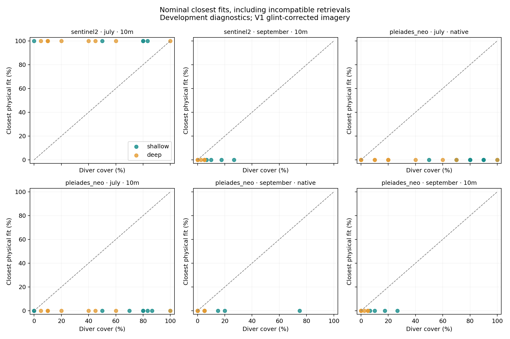

# Sesimbra r7: campaign-matched physical kelp-cover retrieval

Run: 2026-11-02T16:54:43+00:00. Protocol frozen: 2026-11-02T16:47:23+00:00.

The experiment estimates a kelp spectral mixture fraction with fixed Lee physics, depth and spectral references. July and September are evaluated against their own diver observations. No field-cover fitting enters the physical estimate. All field labels were used previously; this is development evidence.

No primary group produced a spectrally compatible cover retrieval. The closest-fit errors below describe rejected estimates; they do not establish kelp detection.

## Primary V1 results

Errors below use the identical units with valid within-campaign baseline predictions. The physical column includes the closest fit even when its spectrum is incompatible; it is a diagnostic of failure as well as accuracy. Compatible counts cover all eligible units.

| Sensor | Campaign | Footprint | Eligible / candidate units | Spectrally compatible | Matched units | Physical MAE (pp) | Depth MAE (pp) | Raw + depth MAE (pp) | Physical bias (pp) |
|---|---|---|---:|---:|---:|---:|---:|---:|---:|
| sentinel2 | july | 10m | 14/18 | 0 | 14 | 57.6 | 27.5 | 29.1 | 57.6 |
| sentinel2 | september | 10m | 12/13 | 0 | 4 | 1.9 | 2.7 | 2.6 | -1.9 |
| pleiades_neo | july | native | 29/30 | 0 | 29 | 49.7 | 22.4 | 24.2 | -49.7 |
| pleiades_neo | july | 10m | 18/18 | 0 | 18 | 47.2 | 32.3 | 34.9 | -47.2 |
| pleiades_neo | september | native | 18/22 | 0 | 18 | 8.3 | 9.6 | 15.5 | -8.3 |
| pleiades_neo | september | 10m | 12/13 | 0 | 4 | 1.9 | 2.7 | 1.8 | -1.9 |

Compatibility means that at least one cover fraction reproduces both blue and green rhos within ±0.001. This is a declared residual tolerance based on the earlier clean-scene variability scale; it is not an accuracy guarantee or a confidence interval. Results at ±0.0005 and ±0.002 are retained in results.json. The absence of an application error tolerance precludes a map-ready verdict.

## Retrieval and comparison

The primary scene products use the existing V1 glint correction; unchanged V0 products are a fixed sensitivity. The 2 July S2 image precedes the 7–8 July dives by 5–6 days. The 31 August S2 and 3 September PNeo images are 1–2 days from the plausible September survey dates. PNeo 8 July is the shallow-survey day and one day after the deep survey. June retains its historical unavailable-scene outcome.

PNeo uses its native multispectral imagery: the native sampling footprint is a 3 × 3 pixel mean (about 3.6 m), alongside 10 m aggregation. S2 uses 10 m pixels. The unchanged r1 pixel masks and fractional valid-area rules apply. Mixed-transect or mixed-stratum cells are excluded from this matched comparison, and every exclusion remains in units.csv. A quadrat mean samples part of a satellite footprint; it does not measure the complete-pixel cover.

Water magnitude comes from the frozen, product-qualified same-day KD490 neighbour. A single factor scales the winter E5s non-water absorption and backscatter shape to that KD490. This remains an assumed summer spectrum. BBP443/CDM443 are retained in the source audit and are not combined into this retrieval before consistency checks.

The fixed borrowed spectral references are the E5s sensor-convolved kelp medians and the mean of turf, coralline-crust and red-foliose medians. The forward model uses the actual blue/green raster wavelengths with centre-band water coefficients; nonlinear band integration remains a model approximation. Fractions are searched on 0–100% in 0.1-point steps. Their relationship to planar diver cover is conditional on the canopy and background model.

Depth-only, mean, raw blue/green and raw-plus-depth baselines are fitted separately within each campaign, with ridge alpha 1 and training-only standardisation. Each fold holds one transect number across both strata and purges shared 10 m cells. Folds require eight training units and three per stratum. Three transect-number groups provide limited independence; cluster-bootstrap intervals and leave-one-group-out changes are descriptive. An interval is not estimated when only one transect contributes. In September the 10 m comparisons retain only four matched units from one transect; their errors do not summarise all 12 eligible cells.

## Sensitivities and limits

Each eligible unit carries scenarios combining KD490 at its central value and ± the provider percentage error bar; the median and each winter spectral shape; effective depth shifts −2/0/+2 m; understory/bare backgrounds; and coherent per-class spectral quartiles p25/median/p75. These are bounded stress scenarios without assigned probabilities. Quartile combinations do not reproduce a measured joint spectral distribution. Provider error bars have no assigned Gaussian confidence level. The depth scenarios also expose sensitivity to canopy height, but do not implement canopy radiative transfer or resolve horizontal positional errors.

Each scenario preserves the two water coefficients as a shared state. Per-band reflectance compatibility uses a box tolerance and makes no independence claim. units.csv records the union of compatible fractions across scenarios, all-scenario closest-fit range, nominal residuals and unclipped effective benthic reflectance. sensitivity.csv.gz records every scenario. Wide ranges or rejected fits must not be interpreted as zero kelp.

No empirical offset, endmember or optical parameter was selected against diver cover. Physics-based fractions cannot distinguish kelp species from spectrally similar vegetation without additional evidence. Water representativeness, borrowed spectra, canopy geometry, geolocation and image residuals remain limits.

The own-physics positive control recovered 240 synthetic combinations with maximum cover error 0 percentage points. This checks implementation with exact inputs. It does not validate the physical assumptions.

## Reproduction

```bash
kelpobserve local-cover --output out/local-cover/new-run
```

registration.json and freeze.json were written before real-cover scoring. input-lock.json pins every raster and reference read; code and package versions are recorded in freeze.json. Existing archived runs remain unchanged. results.json contains all V0/V1 groups, matched metrics, fold support, strata and paired diagnostics.


