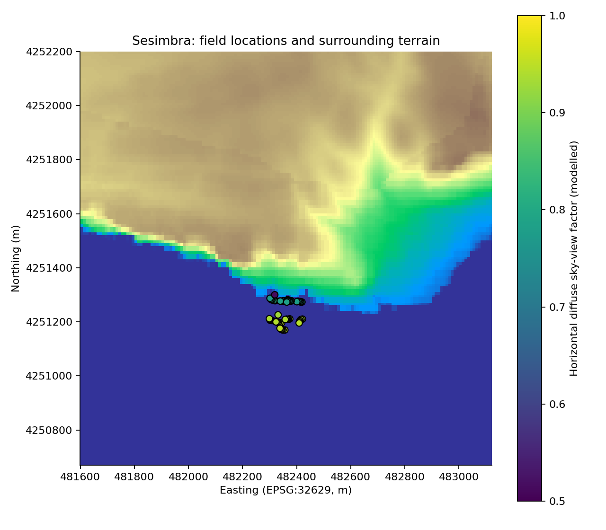
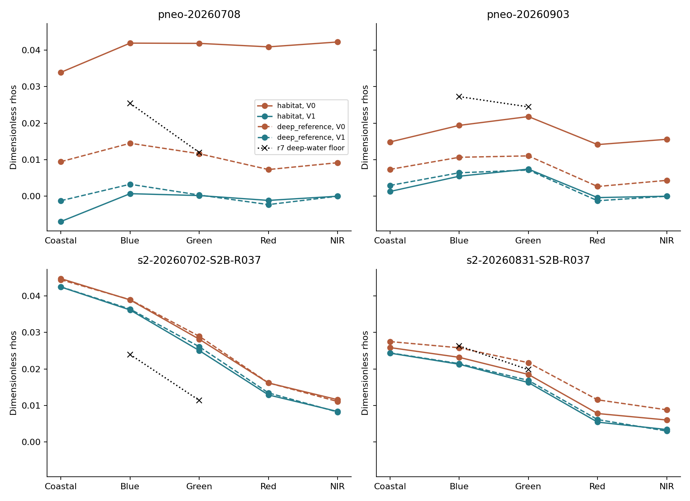

# Sesimbra: radiometry, cliff geometry and water-model closure

Development diagnostic, 2 November 2026. Earlier r7 cover estimates and their failed compatibility result remain unchanged. The design was recorded before these calculations, after inspecting the earlier experiments. No cover target table was read, no correction was chosen using cover, and no new cover score was calculated.

## Findings

Direct cliff shadow does not explain the rejected estimates at the recorded field positions. The cliffs obstruct part of the diffuse sky, and land adjacency remains a possible source of contamination. The current radiometry and water assumptions also disagree over the offshore reference region, where the bottom contribution is small under the nominal water state. The failure therefore extends beyond shaded or incorrectly modelled kelp beds.

There are two separate problems to resolve. The Pleiades Neo NIR-based glint correction leaves substantial negative visible reflectance. The r7 method also assigns water backscatter that differs substantially from the same-day Copernicus BBP product. The latter is a conflict between optical estimates; neither estimate has local field validation.

## Cliff geometry

The terrain combines the original, unmasked EMODnet coastal lidar elevations with Copernicus GLO-30 context where the lidar is absent. Acquisition solar azimuth and zenith come from each processed image's metadata. Horizons were traced every 10 m out to 3 km; the diffuse sky-view calculation uses 5-degree azimuth spacing.

No direct shadow is predicted at any of the 52 registered candidate quadrat locations on the four corresponding image dates: 104 quadrat/image associations. At locations associated with the primary scored footprints, the Sun clears the modelled horizon by at least 56 degrees. Solar azimuth is 130–151 degrees and solar elevation is 56–69 degrees.

The horizontal, isotropic diffuse sky-view factor is 0.70–0.96 at locations associated with scored footprints. This corresponds to roughly 4–30% obstruction of the diffuse sky component. It is **not** a 4–30% reduction in total irradiance: the direct beam remains visible, and the diffuse/direct balance and sky anisotropy have not been measured.

Shifting locations by 20 m, raising obstructing terrain by 5 m and lowering solar elevation by 1 degree creates some apparent shadows. For scored-support locations, every such case places the shifted target on modelled land. All shifts that retain a water target remain unshadowed. Both the unconstrained stress results and the land-position flags are retained in `quadrat-geometry.csv`.

The geometry table contains 92 associations with primary scored footprints. This includes one quadrat without a usable individual cover value sharing a scored Sentinel-2 cell; the earlier cover export has 91 contributing quadrat/image rows. Geometry uses recorded support without reading cover values.

The terrain is a gridded approximation. The 2011 coastal lidar is about 11 by 14 m; Copernicus context is nominally 30 m and includes vegetation and structures. Lidar heights are relative to LAT, whereas Copernicus uses EGM2008. The 5 m stress bound covers a declared vertical perturbation, without establishing datum accuracy. These limitations matter for the immediate cliff edge. The test does not calculate light reflected from cliff faces into the atmosphere or water surface.



## Radiometry

Both V0 and V1 had `adjacency_correction=False`. Within each scene, the aerosol model and reported aerosol optical thickness are unchanged between variants. Top-of-atmosphere reflectance agrees on the paired grid. The V0/V1 difference therefore exposes the registered residual glint correction rather than a different aerosol-model selection.

Sentinel-2 uses a SWIR glint reference. Pleiades Neo uses the alternative NIR-based method. Its offshore NIR is driven to zero by construction; a zero NIR residual cannot validate the correction. The procedure does not distinguish NIR glint from NIR land adjacency or another contaminating signal.

In the July PNeo offshore reference, V1 leaves **28.8% of blue cells and 46.3% of green cells negative**. Red is negative in 99.3% of cells and coastal blue in 54.3%. September PNeo also has negative offshore red in 85.7% of cells. These are fractions of paired 10 m grid cells, not independent sample counts. Negative values were retained. They identify a radiometric problem independent of the assumed water coefficients, although this audit cannot separate atmospheric error, glint over-subtraction and other contamination.

The July PNeo correction removes a median 0.0414 in blue over the full registered habitat AOI, compared with 0.0091 offshore. These AOI-wide quantities differ from the quadrat-only summaries. Median paired removal also differs from the difference between the two marginal medians.



Shore-distance associations use 100 m block medians and adjust for depth and squared depth. In July PNeo, adding shore distance explains less than 1% additional variance in uncorrected blue or NIR and about 2.9% in corrected blue. July Sentinel-2 shows a larger shore dependence in the removed blue component (about 12.3% additional variance). These are descriptive associations across the existing AOI. They do not identify cliff adjacency separately from surf, glint, water gradients or imperfect shoreline geometry. No causal threshold or pixel-wise significance test was applied.

## Water-model closure offshore

The unchanged reference polygon was originally selected by geometry: coarse depth at least 50 m, at least 1 km from land and the habitat AOI, and at least 100 m inside the image footprint. Paired observations cover 48 spatial blocks per image and 2,300–2,868 valid 10 m cells. Coarse block-median depths span approximately 51–102 m. They are not field measurements of depth or optics.

The table compares V1 observed medians with the median finite-depth black-bottom signal predicted by r7. All quantities are dimensionless surface reflectance, `rhos`.

| Image | Observed blue | r7 blue water signal | Observed green | r7 green water signal |
| --- | ---: | ---: | ---: | ---: |
| S2, 2 July | 0.03639 | 0.02396 | 0.02609 | 0.01140 |
| S2, 31 August | 0.02147 | 0.02630 | 0.01687 | 0.01981 |
| PNeo, 8 July | 0.00328 | 0.02543 | 0.00033 | 0.01198 |
| PNeo, 3 September | 0.00642 | 0.02726 | 0.00717 | 0.02446 |

The closure calculation allows bottom reflectance from zero to 0.6 at each cell's depth. The maximum nominal bottom contribution is 0.0011 in July S2 blue, 0.00064 in July PNeo blue, and smaller elsewhere. It is included explicitly; “deep” is not treated as exactly bottom-free. Using the existing ±0.001 diagnostic tolerance, no July S2 or PNeo V1 reference cell matches both bands under the nominal water state. August S2 matches both in 0.35% of cells.

The diagnostic tolerance is not a calibrated sensor uncertainty. The table establishes incompatibility of the tested water/radiometry combinations. It cannot determine which input is correct. Distant adjacency or atmospheric biases can also affect the offshore region.

## Separating absorption and backscatter

The r7 water extension scales winter non-water absorption and particulate backscatter by one common factor until modelled KD490 matches Copernicus. That fixes their relationship without independent summer confirmation. The resulting BBP443 exceeds the same-day Copernicus BBP443 by:

| Image | r7 BBP443 / Copernicus BBP443 |
| --- | ---: |
| S2, 2 July | 1.58 |
| S2, 31 August | 4.12 |
| PNeo, 8 July | 12.30 |
| PNeo, 3 September | 6.98 |

A diagnostic alternative keeps the winter spectral shapes but sets backscatter magnitude from BBP443 and solves absorption magnitude to satisfy KD490. It uses no image reflectance. Nine stress combinations use nominal and plus/minus provider percentage errors in those two products. They are not confidence intervals. Candidate non-water absorption at 443 nm is checked against the CDM443 provider-error lower bound; three July PNeo scenarios conflict with it.

At nominal KD490 and BBP443, the July PNeo reference water signal falls to approximately 0.00494 in blue and 0.00224 in green. Both-band compatibility rises from zero to 27.9% of reference cells. The remaining mismatch persists. Across the non-conflicting stress grid, the largest compatible fractions are 29.3% for July PNeo, 2.7% for September PNeo, and zero for both S2 images. These grid maxima describe sensitivity; they were not selected as operational water states.

The Copernicus neighbour is a daily satellite product, 0.891 km from the reef. KD490, BBP443 and CDM443 have correlated retrieval errors and unresolved local representativeness. The alternative retains the winter spectral shapes. This exercise does not validate either optical product, identify unique IOPs, or justify replacing the r7 water state in a cover map.

## Next development step

Keep the existing cover verdict. Prioritize a small atmospheric/glint-processing comparison on the July S2 and PNeo images, with the same offshore and habitat controls, explicit adjacency treatment and retained negative reflectance. Evaluate absolute spectra and the signal removed from each band, including the NIR reference assumptions. A candidate must first give a credible image-wide water spectrum before another cover run is justified.

Treat absorption and backscatter as separately constrained quantities. The single-factor winter extension is too restrictive to assume without a closure check. The KD490+BBP alternative is a sensitivity result; its residual failures require further qualification. A future processing comparison must keep scene selection and acceptance rules independent of the known cover errors.

Direct-shadow correction is low priority for these four overpasses. Reflected land light and diffuse-sky effects remain open. The current geometry calculation cannot measure their spectral magnitude.

## Files, verification and reproduction

- `design.json`: recorded diagnostic scope and rules.
- `scene-metadata.json`: acquisition geometry and processing settings.
- `radiometry-summary.csv`: paired TOA, surface reflectance and removed signal, including shore-distance bins.
- `paired-grid-cells.csv.gz`: the 87,113 paired cells underlying summaries; imagery-derived samples are spatially correlated.
- `spatial-blocks.csv` and `shore-associations.csv`: 100 m descriptive summaries and depth-adjusted shore associations.
- `quadrat-geometry.csv`: horizon, sky view, stress cases and original-support flags.
- `footprint-radiometry-and-geometry.csv`: water-signal residuals and geometry at the original r7 supports. Several quadrats can share one prediction footprint.
- `deep-water-closure.csv` and `water-states.json`: nominal and externally constrained water scenarios, including conflicts.
- `original-footprint-water-floor.csv`: the 206 previously eligible V0/V1 footprint diagnostics, with no cover fields.
- `terrain-context.tif`: elevation mosaic and coastal-lidar coverage band; `copdem30-context.tif` preserves the downloaded context subset.
- `diagnose.py`, `test_diagnose.py`, `provenance.json` and `verification.json`: reproducible calculations, checks and input hashes.

Four focused tests pass: agreement with the frozen forward model, a known synthetic terrain obstruction, reproduction of the independently specified KD490/BBP constraints, and an impossible optical-state case. All 206 nominal water floors agree with the preceding independently derived quadrat export. The paired source TOA data and aerosol metadata match between variants. Figures were inspected. Existing r7 result-file hashes are unchanged.

From the repository root:

```sh
.venv/bin/python benchmark/reports/r7-optical-diagnostic-20261102/diagnose.py --output /tmp/sesimbra-optical-diagnostic-new
.venv/bin/python -m pytest -q -p no:cacheprovider benchmark/reports/r7-optical-diagnostic-20261102/test_diagnose.py
```

The output directory must be new. The runner writes the numerical evidence and figures; this report interprets those outputs separately.

Terrain attribution: EMODnet HR-DTM `590_HR_Lidar_Sul`, survey 2011, DGT/APA and Instituto Hidrografico; not for navigation. Copernicus GLO-30 DSM was accessed on 2 November 2026 from the [public AWS collection](https://registry.opendata.aws/copernicus-dem/), under the linked Copernicus DEM licence. Its [data description](https://copernicus-dem-90m.s3.amazonaws.com/readme.html) identifies the surface-model and grid characteristics. The downloaded source URL and checksums are retained in `provenance.json`.
