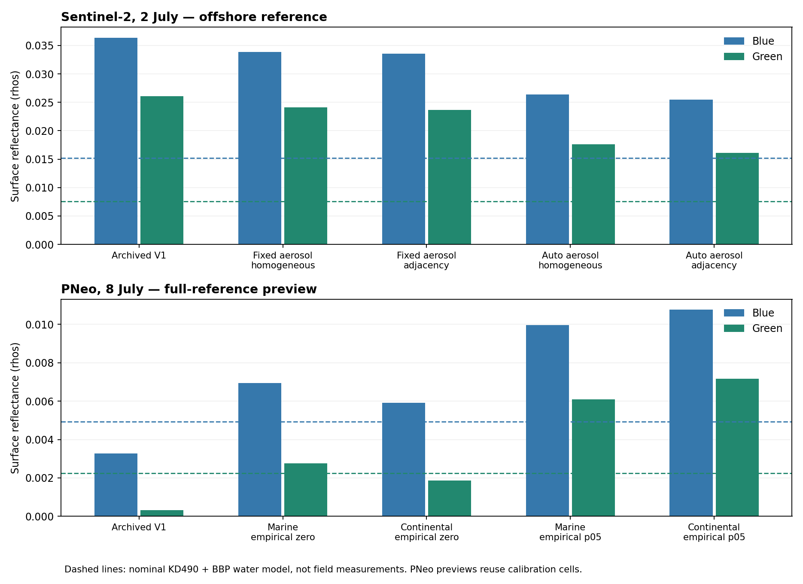

# Sesimbra: atmospheric, adjacency and glint comparison

Executed 3 November 2026 on the 2 July Sentinel-2 and 8 July PNeo scenes. Development data only; no cover labels were read or scored. The recorded design precedes new processing.

No tested branch supports promotion to physical cover retrieval. On Sentinel-2, the selected aerosol solution changes reflectance much more than the explicit adjacency term. It reduces the offshore water-model residual but leaves both bands incompatible. PNeo's continental-aerosol sensitivity does not resolve the spatial inconsistency of the glint/water combination. The conditional shallow-bottom and cover stages remain deferred.

## Processing and support

ACOLITE remains pinned at `64a02ff386e2985eef68ae00198b38e04f3c4a1f`, with its source unchanged. Four atmospheric runs were made:

- Sentinel-2 RAdCor with the original scene-mean marine aerosol/AOT fixed at 0.08087.
- Sentinel-2 RAdCor with automatic aerosol selection; it selected continental aerosol and AOT 0.22224.
- PNeo DSF with the original marine aerosol/AOT fixed at 0.07812, as a reproduction control.
- PNeo DSF restricted to continental aerosol, retaining the original percentile estimator; AOT was 0.09203.

RAdCor writes a homogeneous-surface comparator (`rhosu`) and adjacency-corrected reflectance (`rhos`) under the same atmosphere. Both were retained before and after its standard SWIR glint method. This paired comparison isolates the implemented adjacency effect. The fixed homogeneous comparator differs from archived Sentinel-2 V1: it uses a scalar scene-mean atmosphere and RAdCor geometry, while the archived correction used tiled aerosol estimates. Their difference cannot be attributed solely to adjacency.

PNeo RAdCor is unavailable in this checkout: its PNEO3 coefficients are absent, and the RAdCor glint path does not support the alternative NIR method. Pleiades 1 coefficients were not substituted. PNeo's two atmospheric branches instead received the previously recorded empirical zero-baseline and p05-baseline glint variants, fitted separately in each reference split.

Inputs were repacked from immutable cached TOA and geometry rasters. Every repacked array was checked for exact equality. The Sentinel-2 window has over 5 km of measured context around every evaluation cell, with a 5 km RAdCor kernel and edge extension disabled. The default neighbourhood treatment of the PSF tail beyond the kernel remains an assumption. All 22,572 Sentinel-2 evaluation cells retain complete native support. PNeo uses the full delivered footprint; 21,150 of 21,153 cells retain complete support, with two offshore cells and one habitat cell excluded because a required native band is unavailable.

Every new GeoTIFF uses the original pixel affine. The first standard export exposed a half-pixel CF/GDAL convention difference; this was corrected before scoring by exporting the unchanged arrays on the source grid. The PNeo marine control agrees with archived V0 to 3.2 × 10⁻⁹ rhos after aggregation. Wrapper settings-initialisation errors and the export repair are retained in `implementation-history.json`; neither changed the scientific comparison.

## Sentinel-2 result

After SWIR glint correction, explicit adjacency at fixed aerosol changes offshore blue and green by median −0.00029 and −0.00044 rhos on paired cells. In the habitat AOI the corresponding changes are +0.00022 and −0.00004. These are small compared with the remaining offshore residuals.

Changing from the fixed marine to the automatic continental solution changes offshore blue/green by −0.00828/−0.00771, including the different adjacency correction under that aerosol. This is evidence of sensitivity to atmospheric assumptions, without establishing that the selected aerosol is correct.

| Processing case | Blue median | Green median |
| --- | --- | --- |
| Archived V1 | 0.03639 | 0.02609 |
| Fixed aerosol homogeneous | 0.03384 | 0.02413 |
| Fixed aerosol adjacency | 0.03352 | 0.02366 |
| Auto aerosol homogeneous | 0.02638 | 0.01758 |
| Auto aerosol adjacency | 0.02545 | 0.01611 |

Against the nominal independently specified KD490+BBP water state, the archived V1 offshore residual medians are approximately +0.0212/+0.0185 in blue/green. The automatic aerosol, adjacency and SWIR case reduces them to +0.0103/+0.0085. No reference cell in that case fits both bands at ±0.001 under the nominal state. Across the entire non-conflicting water grid, its best full-reference compatible fraction is below 1%, even at ±0.002. A reduced mismatch therefore does not establish recovered water-leaving reflectance.

## PNeo result

Changing aerosol family shifts the baseline and the empirical glint result, but yields no consistent spatial improvement. The full-reference medians can look close to the water model while the western and eastern reference areas disagree.

| Processing case | Blue median | Green median |
| --- | --- | --- |
| Archived V1 | 0.00327 | 0.00033 |
| Marine empirical zero | 0.00694 | 0.00276 |
| Continental empirical zero | 0.00591 | 0.00187 |
| Marine empirical p05 | 0.00997 | 0.00608 |
| Continental empirical p05 | 0.01078 | 0.00717 |

Both-band compatibility with the nominal KD490+BBP water state at ±0.001, on common support:

| Processing case | Train west, test east | Train east, test west |
| --- | --- | --- |
| Archived V1 | 59.5% | 1.1% |
| Marine empirical zero | 44.3% | 1.0% |
| Continental empirical zero | 33.7% | 0.5% |
| Marine empirical p05 | 0.0% | 0.1% |
| Continental empirical p05 | 0.0% | 0.0% |

The western test area remains around 1% compatible or less. The retained p05 baseline remains ineffective. Across the water stress grid and the doubled ±0.002 tolerance, some full-reference empirical-zero previews reach much higher compatibility (up to about 67% for continental aerosol). This favourable combination was not selected: it uses a wider tolerance, reuses calibration cells, and does not establish spatial transfer or identify the true water state.

## Water-spectrum sensitivity and interpretation

The analysis evaluates the two existing winter QAA spectral shapes separately and their median. Each shape is combined with nominal and ±provider-error KD490 and BBP443, giving 27 externally specified states per scene, plus the old r7 water state. Absorption/backscatter magnitudes are constrained separately. CDM provides an explicit lower-bound check; nine July PNeo states conflict with that bound and remain flagged in the tables.

These alternatives span the two available winter shapes. They do not cover all plausible summer phytoplankton, dissolved-material or particle spectra. Provider errors are not confidence intervals, and their correlations are unmodelled. The daily 1 km Copernicus neighbour still lacks demonstrated reef representativeness. The nominal water spectrum is a conditional comparator, without local field optical validation.

The west/east partitions are held out from empirical glint calibration. Automatic aerosol estimation can use the wider image, including those regions. The partition scores are therefore spatial diagnostics, not independent validation of the entire atmospheric correction.

The results weaken the explanation that a missing adjacency switch alone accounts for the Sentinel-2 mismatch under these settings. They leave atmospheric baseline, aerosol choice, water-spectrum assumptions and water gradients unresolved. They do not rule out cliff effects under other geometries or validate PNeo adjacency correction.



## Consequence for the next stage

Keep the existing physical-cover verdict. The next useful constraint is an independently supported atmospheric or water-leaving-reflectance reference for these dates, together with evidence about the water spectrum. Archived optical matchups or suitable same-day atmospheric observations should be qualified for location, time, units and uncertainty before use. A new fitted offset chosen to match known cover would not resolve the current ambiguity.

No shallow-bottom classifier or cover model was run. Even a good bottom library cannot resolve an offshore mismatch with little expected bottom contribution. The physical model and the image processing remain distinguishable sources of uncertainty.

## Evidence and reproduction

For each offshore cell, the Lee model predicts the blue and green signal at its lidar-plus-water-level depth for bottom reflectance from 0 to 0.6. A cell is compatible when both observed bands fall inside that envelope, expanded by the stated tolerance in dimensionless above-water surface reflectance. The ±0.001 and ±0.002 tolerances are diagnostic sensitivities. They are not sensor uncertainty estimates or new cover-release criteria. The reported cell fractions are descriptive; spatial dependence prevents interpreting these counts as independent replicates.

`evaluation.csv` uses every original eligible cell and reports losses. `evaluation-common.csv` uses common valid support. `paired-changes.csv` contains cell-paired differences; these are not differences between marginal medians. `water-closure.csv` and `water-closure-common.csv` preserve every water state and tolerance. Negative reflectance is retained. No baseline, atmosphere or water state was selected by its best score.

The analysis can be rerun in a new output folder with the benchmark environment:

```sh
.venv/bin/python benchmark/reports/sesimbra-atmosphere-20261103/analyse.py --output /absolute/path/to/new-output
```

`process.py` provides `pack SCENE --cache-root NEW_CACHE` and `process BRANCH --cache-root NEW_CACHE` for a fresh processing cache. Run it in an ACOLITE-capable Python environment; the benchmark environment supplies the analysis dependencies. `process.py`, `analyse.py` and `verify.py` read the `cache` and `acolite` paths from `kelpobserve.toml`. Valid branches are `s2_radcor_fixed`, `s2_radcor_auto`, `pneo_marine_control`, `pneo_continental`. Original TOA caches and the pinned ACOLITE data tables are required. `report.py OUTPUT` regenerates the report and figure.

Post-run verification checks all 58 exported rasters against the unchanged native arrays and pixel grids. The PNeo marine control reproduces all five exported V0 bands exactly at native resolution. All 22 packed source arrays, eight frozen r7 source files and 46 previously manifested result files pass their checks. The common-support intersection and archived controls were independently recomputed. `verify.py --output OUTPUT` runs these checks with the ACOLITE-capable environment; `--comparison-root` additionally compares an earlier analysis run. A new verification run rewrites its verification record, so use a copied result bundle when checking the frozen report.

The report bundle contains the design, processing support inventory, requested settings, processing logs, calibration records, source hashes and verification results. Large native rasters and NetCDF intermediates remain in the separate `.cache/optical-atmosphere-20261103/` directory. No prior experiment or upstream ACOLITE source was changed.
